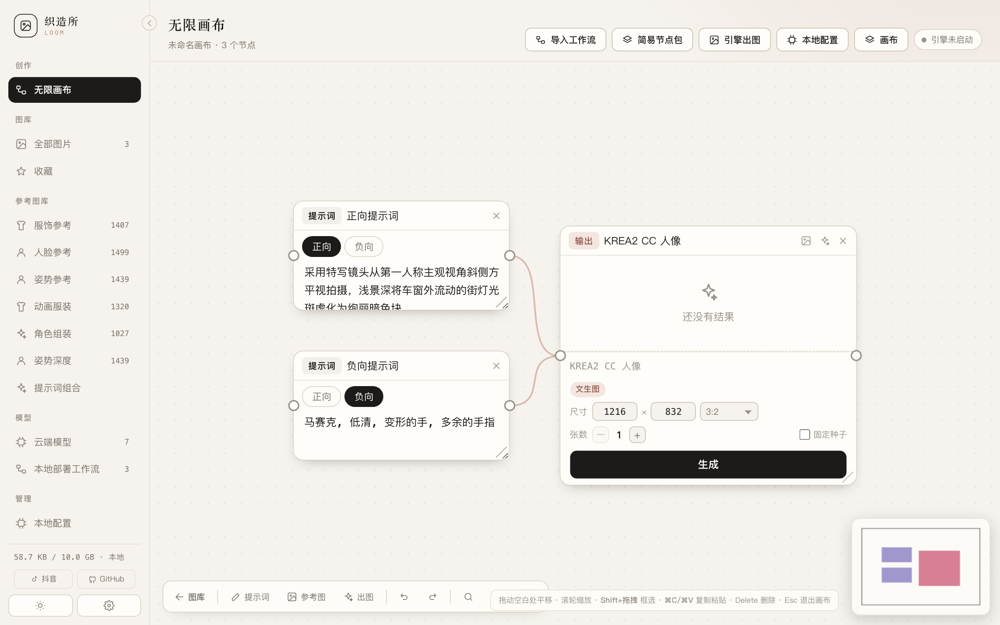
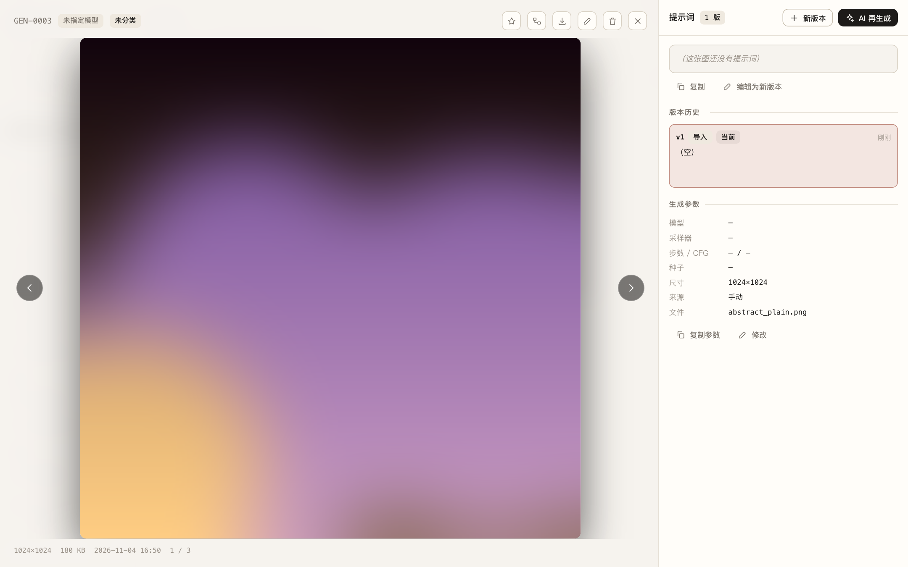
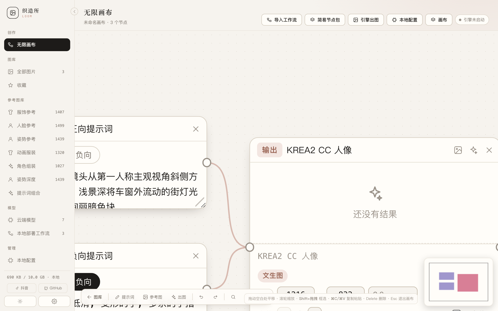
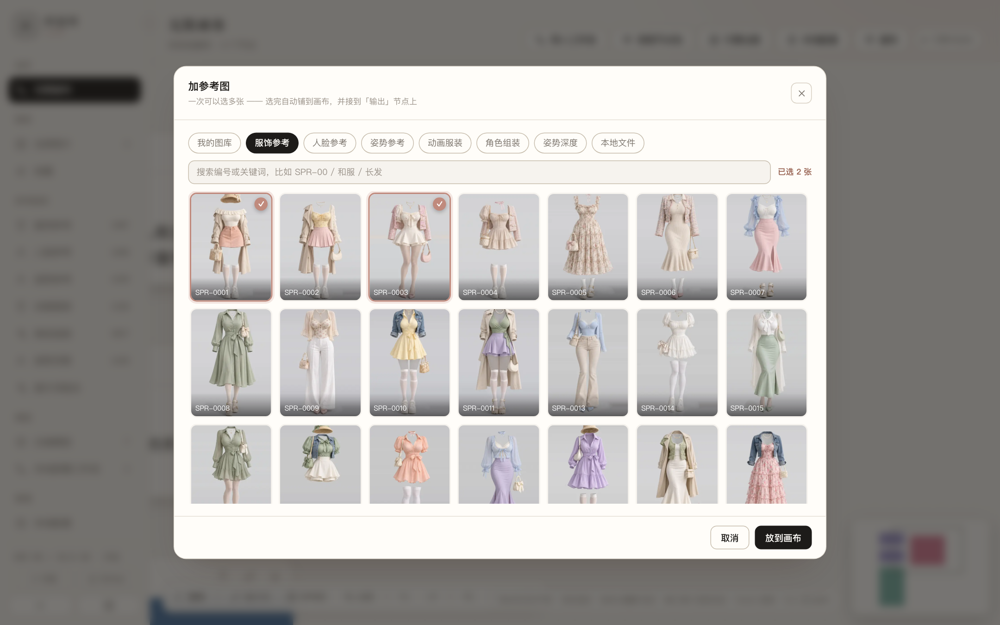
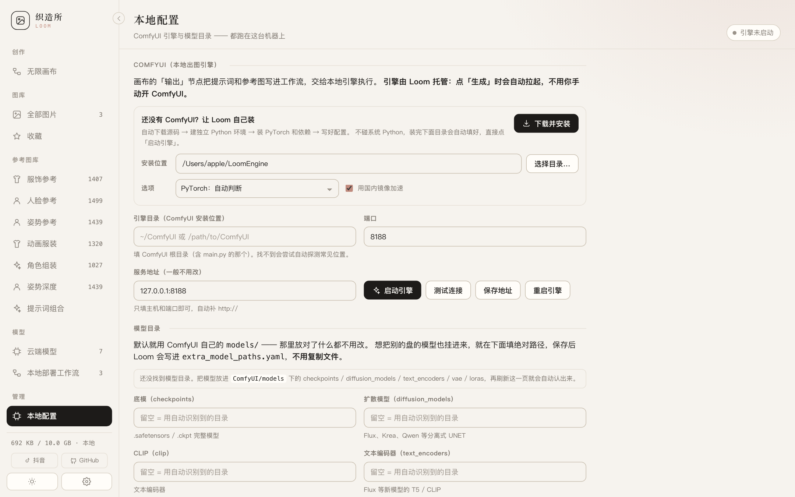
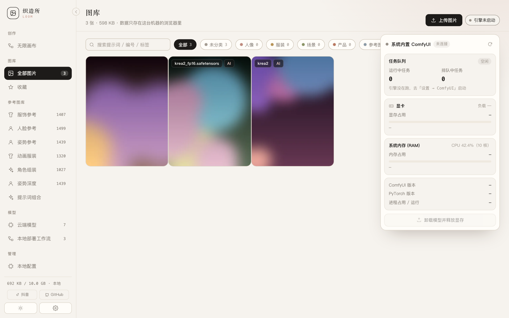

# Loom 织造所

> 本地 AI 出图工作台：图片仓库 · 模型资产 · 参考图库 · 无限画布
>
> 项目仓库 [github.com/Atom-kkk/loom-vault](https://github.com/Atom-kkk/loom-vault) · 作者 [@Atom-kkk](https://github.com/Atom-kkk) · [MIT 许可](LICENSE)

> **第一次用？先看 [《小白图文教程》](小白图文教程.md)。**
> 从「下载压缩包」讲到「第一张图进图库」，每步都有截图，不需要任何前置知识。

本地优先的 AI 出图工作台。把你自己用大模型生成的图集中存起来，连同**模型、LoRA、工作流、提示词、生成参数**一起管理。数据全部留在本机浏览器，不上传任何服务器。联网只发生在你主动触发的场景：调用自己配置的 AI 接口、访问本地 ComfyUI，以及打开参考图时按需下载高清原图（下载后会缓存到本机）。



零依赖、零构建：纯 HTML + CSS + 原生 JS + IndexedDB，不需要 npm install。
配色沿用 **AI-Face-Resource-Library** 的暖纸体系：米白纸面 `#f6f3ee` / `#fffdf9`、墨色 `#1d1b19`、玫瑰点缀 `#c08a7d`，标题用衬线、正文用无衬线；深色是同一套的暖黑反转（`#141311` / `#1d1c1a` / `#efe9e1`），右上角保留一点玫瑰色晕光。

侧栏右缘的小箭头可以把它收成 **62px 图标栏**，给画布腾出空间；状态保存在本机，重开不会弹回去。悬停图标仍能看见栏目名。

### 界面一览

| | |
|---|---|
|  |  |
| 图库：拖入即存，自动解析内嵌参数 | 点开一张图：提示词版本链、参数档案、送去画布 |
|  |  |
| 输出节点：尺寸 / 张数 / 生成，状态行带已用与预计 | 加参考图：三个内置库 + 我的图库 + 本地文件，可多选 |
|  |  |
| 本地配置：引擎安装 / 目录 / 启动，模型路径也在这 | 资源监控：队列、显存、内存、CPU、版本 |

更多截图（参考图库、提示词组合台、云端模型、设置页、遮罩编辑器等 24 张）在 [`docs/screenshots/`](docs/screenshots/)，全部由 `scripts/make_shots.mjs` 从当前版本的真实界面自动截取。

---

## 快速开始

```bash
git clone git@github.com:Atom-kkk/loom-vault.git
cd loom-vault
python3 serve.py                # 启动（或双击 start.command / start.bat）
```

> 只想看图库 / 提示词库 / 参考库，到这里就够用了。
> 要画布出图，**在「设置 → ComfyUI」里点「下载并安装」**，或者用命令行脚本 `scripts/setup-engine.sh`（Windows 用 `scripts\setup-engine.bat`）。首次下载几个 GB，约 10~30 分钟。

**Mac / Linux**：双击 `start.command`
**Windows**：双击 `start.bat`
**手动**：`python3 serve.py`（默认 8787，自动开浏览器）

### 一键装 ComfyUI（图形界面，推荐）

「设置 → ComfyUI」顶部有一块 **「还没有 ComfyUI？让 Loom 自己装」**：

- **安装位置可以自己选**：点「选择目录…」会弹出系统原生文件夹选择框（Windows 是 FolderBrowserDialog，macOS 是 Finder 选择框），可以直接装到 `D:\AI\ComfyUI` 这类盘符，不再受项目目录限制。
- **全程自动**：下载 ComfyUI 源码 → 建独立 `venv`（不碰系统 Python）→ 装 PyTorch → 装 ComfyUI 依赖 → 写入 `.engine.json`，装完上面「引擎目录」自动填好，直接点「启动引擎」。
- **看得见进度**：六个步骤实时高亮，pip 下载百分比实时滚动，失败会显示真实报错而不是「连接被拒」。
- **可中断可续装**：点「终止」只杀当前步骤，已下好的源码、环境、pip 缓存都保留，再点一次接着来。
- **PyTorch 版本可选**：自动判断（macOS 走 MPS、检测到 `nvidia-smi` 走 CUDA 12.4、否则 CPU），也可手动指定 CPU / CUDA 12.4 / 12.6。
- **Python 版本自动处理**：ComfyUI 要求 **Python 3.10+**（源码里大量 `X | None`）。装引擎会自动挑一个 3.10+ 解释器建独立环境；macOS 自带的是 3.9，检测到不够新且装了 Homebrew 时，自动 `brew install python@3.12` 再继续。已有的旧 3.9 环境会改名成 `venv-old` 留档后重建，不会再卡在 `TypeError: unsupported operand type(s) for |` 上。
- **子进程环境隔离**：建环境和起引擎时都会剥掉宿主机的 `PYTHONPATH` / `PYTHONHOME`，避免新环境误加载外部的 `sitecustomize`（表现为启动后无声卡死）。
- **国内网络友好**：pip 默认走清华镜像；镜像缺包（新发布的大包常常滞后）会**自动退回官方 PyPI** 重试，不用你手动改源。源码获取先试 `git clone`，超时或失败自动改用 codeload 压缩包。

装出来的目录结构：

```
你选的目录/
├── ComfyUI/      源码（含 main.py）
└── venv/         独立 Python 环境（Windows 在 venv\Scripts\python.exe）
```

> 必须通过 `http://127.0.0.1:xxxx` 访问，不能双击 `index.html`。
> 浏览器禁止 `file://` 页面使用 IndexedDB，直接打开会提示「数据库打不开」。这是浏览器的安全策略，不是应用的问题。

参考图库的 4345 张缩略图（约 68 MB）已随仓库分发，克隆下来就能直接用。想换源重拉（幂等，已有文件会跳过）：`python3 scripts/fetch_reference.py` 一次性拉全，**国内网络如果卡在 cdn/fastly 节点，用 `python3 scripts/fetch_reference_gcore.py`**——固定走 `gcore.jsdelivr.net`，绕过系统代理，快得多。

想先看看效果：把 `demo/` 里的三张图拖进窗口，其中两张带内嵌参数（A1111 与 ComfyUI），会自动解析出提示词、种子、步数、LoRA。

### 本地出图（无限画布 + ComfyUI 引擎）

画布的「输出」节点能把提示词和参考图写成工作流，交给本地 ComfyUI 出图。Loom 会**自动拉起 / 复用本地引擎**，你不用手动开 ComfyUI：

1. **设置 → ComfyUI → 下载并安装**（或命令行 `scripts/setup-engine`）：自动装好 ComfyUI 引擎（含独立 Python 环境 + PyTorch），并写进配置。装完点「启动引擎」。
2. **模型目录自动识别（一般不用手填）**：打开「管理 → 本地配置」，Loom 会自动扫描并填好六类目录（底模 / 扩散模型 / CLIP / 文本编码器 / VAE / LoRA），每项标「自动识别」并显示找到几个模型、还有几个正在下载。
   **默认就是 ComfyUI 自带的 `models/`** —— 多数人的模型就放在这里，而且 ComfyUI 本身只认这里，放别处还得写配置挂载，多一层就多一个出错点。
   扫描位置按优先级：`ComfyUI/models` → `<安装根>/models` → `~/ComfyUI/models` → `~/ComfyUI-Shared/models`，同一类型取「有内容的、模型多的」那个（同分时取靠前的）。
   启动引擎时会把这些目录**自动写进 `extra_model_paths.yaml`**（只写 ComfyUI 目录之外的，避免模型列表重复），换/升级 ComfyUI 都不会丢模型。
   想手动指定别的目录，直接改输入框再点「保存路径」，会重启引擎使其生效。
3. 导入工作流（或从「简易节点包」拿一个）→ 写提示词 → 点「生成」，Loom 自动拉起引擎出图。

> 首次冷启动引擎 + 加载大模型可能需要 30~90 秒，画布上会显示「启动引擎中…」。
3. **换模型不用重传工作流**：「工作流」页每张卡片上点「切换模型」，可以改主模型 / CLIP / VAE / 每个 LoRA 及其强度，候选来自引擎里真实可用的模型；保存后画布上绑定的同一个工作流下次生成就用新模型。

4. **seed = -1 表示每次随机**：提交给引擎前 Loom 会替换成随机整数，不需要额外装「随机种子」插件（旧版内置工作流依赖 rgthree，已去掉）。

> 模型文件本身不在本仓库（太大），需自行下载 `.safetensors` 放进对应目录。
> 16 GB 内存的 Mac 建议用 fp8 量化的文本编码器（如 `qwen3vl_4b_fp8_scaled`，5.2 GB），bf16 版 8.8 GB 会大量走内存交换，出图很慢。

### 硬件配置参考

本地出图（ComfyUI 引擎）对硬件要求随模型档位拉开差距，按预算对号入座。统一用 fp8 量化文本编码器时，下列配置均可跑 Qwen-Image 2.1 / MOSS-Image 全流程：

| 档位 | Windows | Mac | 适合 |
|---|---|---|---|
| 入门 | 8G 显存 · 32G 内存 | M4 16G | 跑得动，出一张图要等 |
| 基础 | 16G 显存 · 64G 内存 | M5 Pro 48G | 日常使用流畅 |
| 推荐 | 32G 显存 · 96G 内存 | M5 Max 128G | 多图参考编辑无压力 |
| 旗舰 | 96G 显存 · 256G 内存 | M5 Ultra 512G | 批量出图 / 商用产能 |

**显卡推荐（40 系 / 50 系）**

- 8G 显存：4060 / 4060Ti / 5060 等尽可能选显存大的
- 16G 显存：5060Ti 16G（速度较慢）· 5070Ti 16G · 5080 16G · 4090 24G 等
- 32G 显存：5090 · 4090 48G 魔改
- 96G 显存：RTX PRO 6000

欢迎各配置的用户发送实测时间 / 软件 bug：

- 邮箱：[517298997@qq.com](mailto:517298997@qq.com)
- QQ：19744249（添加请备注来源）

### 云端出图（不装 ComfyUI 也能画）

没有好显卡、或不想下载几个 GB 的模型？在**云端模型**页配上云端 API，画布的输出节点就能直接调云端出图，和本地工作流混用：

1. **首次启动自动铺好 8 个主流预设**（接口地址、模型名、调用形态都配好了，只差你填 API Key）：
   - OpenAI：GPT Image 1 / DALL·E 3
   - 智谱：CogView-4
   - 阿里云：通义万相 2.5（DashScope 异步任务，自动轮询）
   - 火山引擎（即梦）：Seedream 4.0
   - Google：Imagen 4
   - Black Forest Labs：FLUX 1.1 Pro
   - SiliconFlow：Kolors
2. 点卡片「编辑」填上 Key（只存本机），「测试连接」验一下配置。
3. **调用形态**：绝大多数中转站走 `images`（`/v1/images/generations`）；少数把生图模型包成对话接口的走 `chat`（从回复里抠图片链接）。不确定就先试 `images`，报「返回里没有图片链接」再换 `chat`。**中转站**：点「添加模型」→ 选「OpenAI 兼容（中转站）」预设，填中转站地址（带 `/v1`）、Key 和它要求的模型名。
4. **画布 → 输出节点 → 点中间那行**，绑定出图方式改成云端模型，写提示词点「生成」即可；结果照常入图库、自动关联模型。
5. 参考图：目前 GPT Image 系（走 `/images/edits`）和 `chat` 形态支持图生图，其余云端模型会提示忽略参考图。
6. 直连被 CORS 挡住时自动回落到本地服务转发（开着 serve.py 或桌面版即可），Key 始终只存在本机。这一页**只显示云端 API 模型** —— 本地基座不单独建卡，文件名显示在「本地部署工作流」的卡片上。

> 云端按量计费，出一张图花一次钱 —— 种类和价格以各厂商控制台为准。

---

---

## 在线体验（纯静态托管）

前端全部是静态文件，可以直接扔到 GitHub Pages / Vercel / 任意静态空间：
界面、图库、三个参考图库、提示词、画布编辑全部可用，数据依然只存在你自己的浏览器里。

没有 `serve.py` 时，能力是这么分布的：

| 能力 | 静态托管 | 本地 `serve.py` |
|---|---|---|
| 图库 / 参考图库 / 提示词 / 画布编辑 | ✅ | ✅ |
| **出图**（本机 ComfyUI 已开的情况下） | ✅ 直连 `127.0.0.1:8188` | ✅ 还能自动拉起 |
| **云端出图**（云端模型页配好 API） | ✅ 浏览器直连，被 CORS 挡住时回落本地服务代理 | ✅ 同左 |
| 一键安装 / 启动 / 重启引擎、模型目录 | ❌ 需要本机文件系统 | ✅ |
| 资源面板的 CPU / 进程内存 / GPU 利用率 | ❌ 读不到本机进程 | ✅ |

**为什么静态页也能出图**：`ensureEngine()` 先问 `serve.py`；问不到就直接探 ComfyUI 的地址。
Loom 启动引擎时默认带 `--enable-cors-header`，所以浏览器能跨域访问它。
「本地配置」页在无后端时会换成一条说明，并只保留「服务地址 / 测试连接 / 保存地址」这三个真能用的控件。

⚠️ 两点现实限制：

1. **浏览器策略在收紧**：HTTPS 页面请求 `http://127.0.0.1` 目前被 Chrome / Safari 放行（127.0.0.1 属于「可信来源」），
   但 Chrome 正在推「本地网络访问」（Private Network Access）许可，将来可能弹权限框甚至直接拦。
2. **安全**：ComfyUI 开着 `Access-Control-Allow-Origin: *` 且没有鉴权，意味着**任何网页都能往你的队列里塞任务**。
   不想承担这个风险就别用在线版出图，或者在 ComfyUI 前面加一层带鉴权的反代。

## 桌面版（macOS / Windows）

不想开终端、不想记端口，就用桌面版：双击图标，窗口里就是完整界面。

**获取方式**

- 打开仓库的 **Actions → Build desktop apps → 最近一次运行**，在页面底部 Artifacts 里下载
  `Loom-macOS`（dmg / zip，arm64 与 x64 各一份）或 `Loom-Windows`（NSIS 安装包 + 免安装 exe）
- 想自己打：`cd desktop && npm install && npm run dist:mac`（或 `dist:win`）

**系统要求**

| | 要求 |
|---|---|
| 系统 | macOS 11+ / Windows 10+ |
| Python | **3.10 或更新**（桌面版靠它跑 `serve.py`；macOS 自带的 3.9 不够） |
| 磁盘 | 约 350 MB（含 68 MB 参考图缩略图） |

没装 Python 时，应用不会白屏，会开一个说明页并给出下载地址。

**首次打开会被系统拦一下**（因为没买代码签名证书）：

- macOS：右键点图标 →「打开」→ 再点「打开」；之后就不拦了
- Windows：SmartScreen 提示「已保护你的电脑」→ 点「更多信息」→「仍要运行」

**它做了什么**

1. 找空闲端口
2. 探测本机 Python（`py -3` / `python` / `python3`，多个候选）
3. 用 `<Python> serve.py <端口> --no-open` 起本地服务
4. 端口通了才 `loadURL`，没通就显示日志片段而不是空白窗口
5. 退出时把 serve.py 连同它拉起的 ComfyUI 一起收掉；被强杀留下的孤儿进程会在下次启动时按 pidfile 清理

网页资源会复制到用户目录（`~/Library/Application Support/Loom/web` 或 `%APPDATA%\Loom\web`），
因为 macOS 的 `.app` 包内是只读的，而 `serve.py` 要往自己目录写 `.engine.json`。

- **内置更新**：应用启动后每天静默检查一次 GitHub Releases（可手动「帮助 → 检查更新…」），发现新版一键下载并打开安装器；直连 GitHub 失败自动切镜像，进度显示在任务栏 / 程序坞上。

## 核心特性

- 🖼️ **图库**：拖入即存，自动解析 A1111 / ComfyUI 内嵌的提示词、种子、步数、LoRA
- 🧩 **无限画布**：节点式连线，正向/负向提示词 + 参考图 → 输出，一键出图；自动拉起本地 ComfyUI 引擎
- 📐 **出图尺寸随手改**：卡片上直接调宽 × 高（图片与视频通用），带 1:1 / 3:2 / 16:9 / 竖屏等常用比例，自动吸附到 64 的倍数
- ⚡ **底栏三个按钮起一张图**：提示词 / 参考图 / 出图，点两下加出图，连线自动接好
- 🖼️ **参考图库一键导入**：服饰 / 人脸 / 姿势三个内置库，多选后成排铺到画布；工作流有 `ref_image_xx` 图位时自动连线，没有就不画假线并说明原因
- 📊 **资源监控**：顶栏常驻「运行中 / 排队 / 显存」，展开看显卡、内存、CPU、版本；生成节点上有已用时间与预计剩余
- 🎭 **参考图库**：内置 4300+ 张服饰 / 人脸 / 姿势参考，按需加载高清原图
- ✍️ **提示词版本链**：改一版存一版，永不覆盖，随时回退对比
- 🧩 **模型**：云端模型（API 出图）集中配置，内置主流厂商预设；本地基座不单独建卡，文件名显示在「本地部署工作流」卡片上
- 🔒 **纯本地**：零依赖、零构建、数据全在本机浏览器，不上传任何服务器

## 它解决什么问题

用 AI 出图的人通常有四个地方在漏东西：

1. **图存得乱** —— 一堆 `ComfyUI_00031_.png` 散在下载文件夹，过两周完全想不起来哪张是用什么跑出来的。
2. **参数丢了** —— 好图想复现，种子和提示词只存在聊天记录里。
3. **提示词只有一版** —— 用 AI 改着改着把原始那版覆盖了，回头想对比早期版本找不回来。
4. **本地部署资产散落** —— 模型哪天重装系统，checkpoint / LoRA / VAE 的下载链接、放置路径全得重新翻网页。

这个仓库把四件事收在一处：**图 + 参数 + 提示词版本链 + 部署清单**。

---

## 功能

### 图库

- 统一的 3:4 网格，最新优先；支持编号 / 提示词 / 标签 / 备注全文搜索
- 分类页签、收藏、四种排序（最新 / 最早 / 编号 / 随机）
- **筛选抽屉**：模型 / 工作流 / 来源 / 只看有参考图，可叠加，按钮上显示生效条数
  　想回答「这套 LoRA 都出过什么」「用这个工作流跑过几批」这种问题，就是这里
- 点击进入灯箱：大图 + 右侧信息面板，`← / →` 翻页，`Esc` 关闭，手机可横向滑动
- 下载原图、编辑元数据（分类 / 模型 / 标签 / 备注 / 种子）、删除
- 一键复制提示词或完整参数快照

### 上传与自动解析

拖拽或选择文件即可入库，多选、批量统一设置分类与模型。**上传时会读 PNG 里烧进去的生成参数**：

| 来源 | 读取字段 | 解析内容 |
|---|---|---|
| A1111 / Forge | `tEXt:parameters` | 正向 / 负面提示词、Model、Sampler、Steps、CFG、Seed、Size、Denoise、Clip skip、Lora hashes |
| ComfyUI | `tEXt:prompt`（API JSON） | 顺着 KSampler 的 positive/negative 连线取文本；ckpt 名、LoraLoader、seed、steps、cfg、sampler、EmptyLatentImage 尺寸 |
| NovelAI | `tEXt:Comment` | prompt / uc / steps / scale / seed / sampler |
| 其他 | `iTXt`、`zTXt`（zlib 压缩） | 键值对原样保留 |

PNG 的 `tEXt` / `iTXt` / `zTXt` 三种文本块都支持，压缩块用 `DecompressionStream` 解 zlib。
识别到的模型名会和云端模型做模糊匹配，匹配上就直接挂好关联。

### 提示词版本链（不覆盖）

每张图的提示词是一串**只追加的版本**，不是一段可被覆盖的文本：

- 手动编辑 → 新增一版（标记「编辑」）
- AI 生成 → 新增一版（标记「AI」）
- 导入解析出的原始提示词 → 第 1 版（标记来源，如「A1111 / Forge」）

版本列表显示编号、来源、时间、字数，可随时**设为当前**、复制、删除某一版。
当前生效的那一版决定卡片上显示的提示词与搜索命中的内容，历史版本原样保留。

### AI 生成：服务商 + 智能体两层

不做「只能填一个接口」的设计，拆成两层：

**服务商（Provider）= 一个接口端点**，可以同时挂很多个，谁便宜谁快用谁：

| 类型 | 默认地址 | 需要 Key |
|---|---|---|
| DeepSeek | `https://api.deepseek.com` | 是 |
| 智谱 GLM | `https://open.bigmodel.cn/api/paas/v4` | 是（`glm-4v-plus` 支持看图） |
| 本地 Ollama | `http://127.0.0.1:11434/v1` | 否 |
| 本地 LM Studio | `http://127.0.0.1:1234/v1` | 否 |
| OpenAI | `https://api.openai.com/v1` | 是 |
| 自定义 | 任意 OpenAI 兼容网关（vLLM / OneAPI / 自建） | 看情况 |

选类型会自动填好地址和常用模型，也能一键「从服务商拉取模型列表」（本地 Ollama / LM Studio 直接列出你已下载的模型）。

**智能体（Agent）= 服务商 + 模型 + 一套人设**。人设就是系统提示词加温度，决定它怎么写：

| 内置智能体 | 行为 |
|---|---|
| 提示词工程师 | 结构化英文提示词：主体 → 细节 → 服装材质 → 姿态 → 镜头 → 光线 → 画质 |
| 极简派 | 只留影响最大的要素，40 词以内，不堆画质词 |
| 写实摄影 | 强制写机身焦段、光圈景深、现场光、胶片色彩科学 |
| 二次元绘师 | danbooru 标签流，质量词前置，适配 SD / NAI |
| 负面词专家 | 只写负面提示词，分组覆盖常见缺陷 |
| 中英转换 | 中文描述重排成英文提示词，不逐字直译 |

六个都能改，也能从零新建。想让某个智能体走本地模型，选个 Ollama 服务商就行。

**生成时选智能体**：灯箱里点「AI 再生成」，面板顶部一排智能体会出现，点谁就用谁写；会记住上次选的。九种生成方式：润色细化 · 同风格变体（一次出 3 条）· 扩写 · 换风格 · 中译英 · 按参数反推 · 精简 · 生成负面词 · 看图反推。

> Key 以明文存在本机浏览器里，只在你点生成时发给对应服务商的地址。公共电脑上不要填。
> 本地模型连不上时，先确认服务在跑，并且允许跨域：Ollama 用 `OLLAMA_ORIGINS=* ollama serve`，LM Studio 在 Server 设置里打开 CORS。

### 参考图库（内置三个）

把自己的三套开源素材库直接搬了进来，**4345 张缩略图全部本地化**，断网也能翻：

| 库 | 数量 | 能做什么 |
|---|---|---|
| **服饰参考库** | 1407 张服装参考图 · 8 个分类 | 搜索编号/关键词（中英）、按分类筛、复制关键词、一键拼成品提示词、让智能体扩写成完整提示词 |
| **人脸参考库** | 1499 张（正面 893 + 造型 606） | 按分区与发长筛、看原图尺寸、作为角色一致性参考 |
| **姿势参考库** | 1439 张人体姿势 · 4 体系 / 26 动作 / 5 视角 | 按体系·动作分类·视角三维交叉筛选、用作姿势参考、纳入提示词组合台 |

**缩略图本地、原图按需加载**：打开参考图灯箱，或把参考图放进画布节点时，会先显示本地缩略图，再后台下载高清原图并替换。人脸原图约 1122×1402，服装原图约 1366×2048。下载过的原图缓存进 IndexedDB（最多 40 张），下次离线也能显示；设置页可以单独清理这份缓存。下载超时或失败会自动换备用 CDN，仍失败就保留缩略图。画布生成和「存入图库」也优先使用已下载的原图。

三个库都能：点开看大图（`← / →` 翻页）、下载、**一键存入自己的图库**（自动归到「参考图」分类并保留来源编号）、**加入提示词组合台**、跳回源站。
图片版权归原作者，详见下方「素材来源」。

### 提示词组合台

参考库里挑一张脸、一套衣服，直接拼成一条能出图的完整提示词：

```
portrait of a young woman, medium-long hair,
wearing cream blouse ribbon ivory mini skirt beige tights,
standing, natural pose, soft window light, 85mm lens,
shallow depth of field, photorealistic, fine skin detail, subtle film grain
```

- 左栏两个槽位：**脸**（取发长 / 分区）与**服装**（取关键词），各带「换一张 / 清除」
- 右栏是可编辑的拼接结果，按「人物 → 服装 → 姿态 → 光线镜头 → 画质」四段组成
- **AI 润色成片**：把两边的信息交给当前智能体，重写成一条更自然、更连贯的提示词
- 一键复制

> 说明：这条提示词描述的是「长相的大致特征 + 服装款式」。想真正固定同一张脸，把选中的脸图作为参考图 / 图生图输入，比纯文字准得多。

**组合会记进历史**：复制或 AI 润色时自动留档（最多 40 条），底部「最近组合」里点一下就能还原当时的脸、服装和提示词，不用重新挑。

### 无限画布（接 ComfyUI）

一块自由摆放的布，把「提示词 → 生成 → 结果」连成一条线，直接跑本地 ComfyUI。

- **平移缩放**：拖空白处平移，滚轮以光标为锚点缩放（20%–240%），`适应窗口` 一键框住全部节点
- **节点**：画布里只有**简易节点**（提示词 + 负向 + 参考图 + 生成，写在自己卡片里）和从图库送进来的参考图；拖标题栏移动，Delete 删除，右下角手柄自由拉伸
- **连线**：从节点右侧圆点拖到另一个节点左侧圆点（参考图连到简易节点做图生图）
- **多画布**：顶部「画布」里新建 / 切换 / 重命名 / 删除，各自独立保存
- **撤销 / 重做**：`⌘Z` / `⇧⌘Z`（Windows 用 `Ctrl`），最多 60 步；拖节点、连边、改提示词、换图都能退回去
- **自动保存**：改动 0.5 秒后写入 IndexedDB，关掉再开还在；图片按 `blobId` 存放，重开自动重新解析地址
- **中途可取消**：生成时按钮下方出现「取消」，一按即 `POST /interrupt` + 清空排队；节点回到可生成状态，不会报成红色错误
- **刷新不丢任务**：节点会记住引擎的任务编号（promptId），刷新 / 关掉标签再回来会**自动接回**正在跑的任务，跑完照常入库
- **「引擎出图」导入**：顶栏按钮列出 ComfyUI `output/` 里的图，单张或全部导入图库，PNG 内嵌参数照样解析
- **模型目录自动识别**：「本地配置」打开即扫描并预填底模 / 扩散模型 / CLIP / 文本编码器 / VAE / LoRA 六类路径，启动引擎时自动写进 `extra_model_paths.yaml`
  - **默认就是 ComfyUI 自带的 `models/`** —— 那是 ComfyUI 唯一认的目录，放这里最省事；安装目录旁的共享 `models` 只在自带目录空着时才顶上
  - 同类型有多个候选时按「有内容 > 模型多 > 根目录靠前」打分，不会因为某个空目录排在前面就选错
- **出图尺寸随手改**：输出节点上直接填宽 × 高，图片和视频同一套逻辑
- **资源监控**：顶栏右侧一个胶囊常驻显示「运行中 1（排队 3）· 显存 94%」，点开是显卡 / 内存 / CPU / 版本 / 释放显存面板，详见下面「资源监控与预计时间」

**出图尺寸（图片 / 视频通用）**

工作流标了 `width` / `height`（或一个 `size` 顶两个）时，输出节点上会多出一行：

```
尺寸  [1216] × [832]  [3:2 ▾]
```

- **只有工作流声明了尺寸槽位才出现** —— 没标就别显示，改了也不会生效，不如不给假按钮
- **自动吸附 64 的倍数**：ComfyUI 的 latent 按 8 对齐，这里统一按 64 取整（某些模型要求 64），输入 1000 会在失焦时变成 1024
- **范围 64 ~ 4096**，超出夹回边界
- **预设比例**：1:1 / 3:2 / 2:3 / 4:3 / 3:4 / 16:9 / 9:16，外加两个视频常用档（1280×704 / 704×1280）
- **视频工作流**会多出一行「时长」（秒），和尺寸走同一套槽位协议
- 用户改过的值存在节点上（`data.width` / `data.height`），**没改过就用工作流里原本的宽高** —— 不会因为 UI 没碰过就悄悄重置成 1024

**底栏三个按钮：从零到出图只要点三下**

画布左下角工具条上：`图库 | 提示词 参考图 出图 | 撤销 重做 | 适应 100%`

- **提示词**：放一个提示词节点。第一次给正向，再点一次自动给负向（缺哪个补哪个）
- **参考图**：打开选图弹窗 —— 我的图库 / 服饰 / 人脸 / 姿势 / 本地文件，**支持多选**
- **出图**：放输出节点，自动绑内置工作流，并把画布上还没连线的提示词统统接过来

新节点按类型自动排位：提示词往下叠、输出节点排在提示词右侧、参考图再排到输出节点右边并连好线。
不用自己拉线，也不用担心节点盖在一起。

**参考图库一键导入**：

内置的三个库（1407 / 1499 / 1439 条）在弹窗里直接可翻、可搜（编号前缀或关键词），
选中的图点「放到画布」就成排变成参考图节点。**工作流声明了 `ref_image_xx` 图位时才会自动接到输出节点**；
没有图位（内置的 KREA2 是纯文生图）就只放图、不连线，并明确告诉你原因 —— 画一根传不进去的线，比不画更误导。
一次最多 60 张。

**画布缩放现在用 zoom 而不是 transform**

原来放大到 200% 以上，文字边缘会有明显灰晕（整层被栅格化再拉伸）。现在改成 CSS `zoom`：
按缩放后的字号重新排版渲染，**放多大都锐利**。代价是缩放时要做一次布局计算，
换来的是拖拽、滚轮锚点、框选、小地图这些全部照旧（实测锚点偏差 0.5px）。

**资源监控与预计时间**

顶栏右侧常驻一枚胶囊，一眼看出机器还撑不撑得住：

```
● 运行中 1（排队 3）· 显存 94%
```

点开是完整面板：

| 块 | 显示什么 | 数据来源 |
|---|---|---|
| 任务队列 | 运行中 / 排队中数量，本任务已用时间 | `GET /queue` |
| 显卡 | 型号、GPU 负载、显存占用条 | `/system_stats` + `nvidia-smi` |
| 系统内存 | RAM 占用条、CPU 占用与核数 | `serve.py` 新增的 `/engine/sys` |
| 版本 | ComfyUI / PyTorch 版本、引擎进程内存与运行时长 | 同上 |
| 卸载模型 | 一键 `POST /free`（`unload_models` + `free_memory`），跑完大模型腾地方 | ComfyUI 原生接口 |

进度条颜色跟着危险程度走：正常为灰，≥80% 转黄，≥92% 转红。拿不到的数据显示 `—` 而不是 `0%`——宁可说「不知道」，也不假装机器很闲。

**每张图要跑多久，画布上直接告诉你**：

```
第 1/3 张 · 生成中 8/20 · 已用 00:07 · 剩余约 00:24
```

- 有 WebSocket 步进进度 → 按「每步秒数」外推，用指数滑动平均压噪；批量时把后面还没跑的张数也算进去
- 没有进度（Apple MPS、单步长采样、WS 连不上）→ 用**同工作流 + 同批量**的历史中位耗时倒推；超过历史就显示「快好了」，不吐负数
- 历史耗时存在 `localStorage` 的 `vault.gen.dur`，每类保留最近 6 次；中位数而非均值，偶尔卡一次 27 分钟不会把估计带偏
- 每秒只改状态行那一行文字，不重建节点——重建会把画布输入焦点和滚动位置弄丢

**监控本身不该成为负担**：面板打开时 1.5 秒刷新一次，收起后 8 秒一次，页面切到后台直接停；`/engine/sys` 在服务端还有 2 秒缓存（`ps` / PowerShell 这类调用不便宜）。


**简易节点怎么跑**：提示词、负向、参考图都写在卡片里，点「生成」，会：

1. 取卡片里的正向 / 负向文本，写进工作流的 `CLIPTextEncode`
2. 参考图先 `POST /upload/image` 传进 ComfyUI，把返回的文件名填进 `LoadImage`
3. `POST /prompt` 提交，同时连上 ComfyUI 的 **WebSocket**，实时收 `progress` 事件
   —— 简易节点上会显示 `12 / 30` 和一条进度条，不再只是「生成中… 8s」这种模糊计时
   连不上 WS（跨域或版本不支持）会**自动退回轮询**，功能不受影响
4. `GET /view` 把出图拉回来，在右侧自动生成一个图片节点，可以继续往下连

**跑起来之后能控制什么**（这几条都是踩过坑之后补的）：

| 场景 | 行为 |
|---|---|
| 想停下 | 生成中按钮下方出现「取消」→ 中断当前任务 + 清空排队。ComfyUI 只在步与步之间检查中断，所以重模型要等当前这一步跑完；卡在**加载模型**阶段时中断无效，到设置页「重启引擎」强制中断 |
| 刷新 / 关标签 | 节点存了 `promptId`，重新进画布会接回任务、跑完入库，状态标「刷新后接回」。接不回来会明说原因，不会一直转圈 |
| 任务早没了但卡片还在「生成中」 | 进画布时问一次引擎队列，引擎空闲就自动复位成「上次的生成已中断（点生成重来）」 |
| 图已经在硬盘上了 | 顶栏「引擎出图」→ 单张 / 全部导入，读 PNG 内嵌参数入库 |
| 长任务超时 | 等待上限 60 分钟；超时提示会告诉你「任务应该还在引擎里跑，刷新会自动接回」 |

**三种参考图用法都支持**：

| 连了几张 | 行为 |
|---|---|
| 0 张 | 纯文生图，工作流里的 `LoadImage` 保留原值 |
| 1 张 | 填进第一个 `LoadImage` |
| 多张 | **按连线顺序依次填进各个 `LoadImage`**（节点 id 升序），填不完的会提示 |

生成节点上会显示 `3 张参考图 / 2 位` 这样的提示 —— 前面是你放了几张，后面是工作流里有几个图位。超出的部分会弹提示告诉你哪几张没用上；工作流里一个 `LoadImage` 都没有时，会直接报错而不是静默忽略。

**导入 ComfyUI 工作流 = 自动变成简易节点**：顶部「导入工作流」，两种格式都认，**导入 UI 格式会顺手转出一份 API 格式**。导入后画布上就是一个**简易节点**（提示词 + 负向 + 参考图 + 生成），同时自动收进「简易节点包」，**不用手动点打包**。**画布里只有简易节点，不显示完整节点图**——工作流的增删改全程在 ComfyUI 里做，画布只负责生图。

| 格式 | 识别方式 | 能不能直接生成 |
|---|---|---|
| UI 格式（ComfyUI 里普通 Save） | 读 `nodes[].pos` 还原位置、`links[]` 还原连线、`widgets_values` 显示参数 | ✓ 自动转 API 后可以 |
| API 格式（Export (API)） | 按依赖深度自动分层布局，输入连成边 | ✓ |

**工作流槽位协议（让 UI 跟着工作流长）**

工作流里有哪些参数值得用户改，由工作流自己说了算——在 ComfyUI 里把节点的**标题**（`_meta.title`）改成下面的保留名即可：

| 槽位名 | 干什么 | 写进哪个输入 |
|---|---|---|
| `prompt` | 正向提示词 | 文本节点的 `text` / `value` |
| `negative_prompt` | 负向提示词 | 同上 |
| `seed` / `steps` / `cfg` / `denoise` | 采样参数 | 数值节点的 `value` / `seed` |
| `width` / `height` / `batch` / `duration` | 尺寸、张数、时长 | 数值节点 |
| `size` | **一个顶宽高两个**，用于宽高在同一节点的情形（`EmptyLatentImage` / `EmptyLatentVideo`） | 节点里的 `width` + `height` 两个输入 |
| `ref_image_01` ~ `ref_image_09` | 参考图，**编号就是优先级** | `LoadImage.image` |
| `ref_mask` | 重绘遮罩（白 = 重绘） | `LoadImage.image` |
| `first_frame` / `last_frame` | 首帧 / 尾帧 | `LoadImage.image` |

**能力不用另外声明，标了什么就是什么**：

| 标了 | 自动推导出的能力 |
|---|---|
| 只有 `prompt` | 文生图 |
| 有任意 `ref_image_NN` | 图生图（显示「N 个图位」） |
| 有 `ref_mask` | 遮罩重绘（图片节点出现画笔） |
| 有 `first_frame` + `last_frame` | 首尾帧 |
| 只有 `first_frame` | 视频（首帧） |

举一个 API 格式里的样子（在 ComfyUI 里就是把节点标题改成 `prompt`、`seed`、`ref_image_01`）：

```json
{
  "298": { "class_type": "PrimitiveStringMultiline", "inputs": { "value": "…" }, "_meta": { "title": "prompt" } },
  "301": { "class_type": "PrimitiveInt", "inputs": { "value": 4747 }, "_meta": { "title": "seed" } },
  "289": { "class_type": "LoadImage", "inputs": { "image": "a.png" }, "_meta": { "title": "ref_image_01" } }
}
```

细节：

- 名字**大小写、空格、短横线都宽容**（`Ref-Image 01` 也认）
- 参考图按编号**数值**排序（`_2` 排在 `_10` 前面），编号就是「第一张图进哪一路」
- 同一个槽位标了两次 → 取第一个并提示；槽位节点没有可写输入 → 提示哪个节点有问题
- **没标注也能用**：会退回旧的「按节点类型 + id 顺序猜」规则，画布上标「按类型猜 · 未标注」，多图位/遮罩场景建议补标注
- 从 UI 格式导入时节点标题会跟着转进 `_meta.title`，所以**在 ComfyUI 里标好再导出**就能一路带过来

> 为什么值得标：不加标注时，多图位、遮罩、首尾帧这些「长得都像 `LoadImage`」的节点只能靠 id 顺序猜，一定会错位。标一次，之后 UI、遮罩、批量都能对上。

**画布极简**：画布里只有简易节点（和从图库送进来的参考图），所有节点都能用右下角手柄**自由拉伸**（左右上下都可）。

**简易节点包**：顶栏「简易节点包」，只留「已收录」清单——导入过的工作流都会自动收在这里，点一下就能放上画布生图，不掺任何模板配置（模型、LoRA、参数都在 ComfyUI 里定）。

**小白手册**：从来没装过 ComfyUI 的，看 [小白图文教程.md](小白图文教程.md) —— 从下载压缩包讲到第一张图进图库，每一步都有截图和「你应该看到什么」。
画布的功能与设计意图，见 [无限画布使用手册.md](无限画布使用手册.md)（1100+ 行）。

**UI → API 是怎么转的**（`Comfy.uiToApi`）：拉一次 ComfyUI 的 `/object_info` 拿到每个节点类型的输入定义，然后

1. **连线**：输入名直接取自 `node.inputs`，所以 **widget 输入被链接也能接上**（比如 rgthree 的 Seed 节点连到 KSampler 的 seed）；`links` 数组只在 `node.inputs` 缺失时兜底
2. **旁路直通**：被旁路（mode 4）的节点和 `Reroute` 不会提交，但**连线会沿它们的输入直通到上游**——`UNET → 旁路LoRA → 旁路LoRA → LoRA` 转出来就是 `UNET → LoRA`，模型链不断
3. **参数**：按 `/object_info` 里 `required` + `optional` 的键顺序，把 `widgets_values` 逐个填进对应的 widget；widget 输入即使被链接也仍占一个参数位（`seed` 后面那个 `randomize`/`fixed` 控制项会自动跳过）
4. **过滤**：`Note`/`PrimitiveNode` 不提交，静音（mode 2）的节点跳过并记警告（它的输出会断，需要自己处理）

转换后会自动存两份工作流：原始 UI 版 + `· API` 版（用来跑），简易节点绑定后者。

> **跨域不用改 ComfyUI 启动参数**：新版 ComfyUI 会拒绝陌生 Origin（403、无 CORS 头），浏览器直连必挂。`serve.py` 自带本地反向代理 `/comfy?u=<目标>`（只监听 127.0.0.1），前端请求直连失败会自动改走代理并记住，对 `--enable-cors-header` 和桌面版同样兼容。旧版 serve.py 没有这个代理，改完代码记得重启 `serve.py` 再刷新页面。

### 图库 → 画布：把旧图变成下一轮的起点

图库不是终点。灯箱顶部有个箭头图标「送去画布」，三种用法：

| 方式 | 结果 |
|---|---|
| **作为参考图** | 加一个参考图节点，连到简易节点就是图生图（拿旧图当脸 / 当衣服 / 当构图） |
| **作为图片节点** | 只放到画布上做对比、拼图，不参与生成 |
| **用这套参数复现** | 生成一个**简易节点**，当时的提示词（含负面）和参考图都填好，工作流也绑好，直接就能重跑 |

「复现」是把这张图入库时记下的东西原样还原：当时的提示词版本、`refIds` 里的参考图编号（自动去参考库里取缩略图）、以及绑定的工作流。所以想看「这套 LoRA 换个种子会怎样」，点一下就能重跑，不用凭记忆重搭。

> 原图没有关联工作流时，简易节点会空着并提示手动绑定 —— 从 A1111 导入的图通常没有 ComfyUI 工作流。

### 云端模型

这一页只放**外接 API 的云端模型**（本地基座不单独建卡，文件名显示在「本地部署工作流」卡片上）。

首次启动预置 8 个主流厂商预设（接口地址 / 模型名 / 调用形态都配好，只差 Key）；「添加模型」支持任何 OpenAI 兼容端点和中转站。字段：名称、平台、基座、版本、接口地址、API Key、模型名、调用形态（images / chat / dashscope / bfl / google）、出图尺寸、说明；「测试连接」验配置。

### 本地部署工作流

- 上传 ComfyUI 导出的 `.json`（或带 workflow 的 `.png`），自动数出节点数、猜出关联模型，可随时下载原文件。
  卡片副标题直接显示**当前主模型文件名**；右上角「切换模型」可以改主模型（UNETLoader / CheckpointLoader）、CLIP（含 DualCLIPLoader 双槽）、VAE、每个 LoRA 及其强度——
  候选来自当前引擎 `/object_info` 里真实可用的模型（可下拉可手填），保存即写回工作流 JSON，**画布里绑同一个工作流的节点下次生成就用新模型，不用重新上传**。

### 分类（图库页内管理）

内置六个（未分类 / 人像 / 服装 / 场景 / 产品 / 参考图），图库工具条「分类管理」里增删改，自定义名称、编号前缀、颜色。
编号规则 `前缀-四位序号`，按分类独立计数，删除图片不回收编号。删除分类时其下图片自动迁移到其他分类，不会丢图。

---

## 数据存在哪

全部在浏览器的 **IndexedDB**（库名 `aivault`）：

| 表 | 内容 |
|---|---|
| `images` | 图片元数据：编号、分类、模型、尺寸、参数、提示词版本链、标签 |
| `blobs` | 原图与 640px 缩略图的二进制 |
| `models` | 模型：类型、平台、基座、ComfyUI 地址、部署文件清单 |
| `loras` | LoRA：基座、触发词、下载链接 |
| `workflows` | 工作流：JSON 文本、格式、节点数 |
| `categories` | 分类：名称、前缀、颜色、序号 |
| `settings` | 服务商 `aiProviders`、智能体 `aiAgents`、上次选用的智能体等 |
| `canvases` | 画布：节点、连线、视口位置 |
| `meta` | 各分类的编号计数器 |

注意三点：

- **换浏览器 / 换设备看不到** —— IndexedDB 按「源」隔离，`127.0.0.1:8787` 和 `localhost:8787` 是两个不同的源，上传后请固定用同一种方式打开。
- **清浏览器数据会丢** —— 定期用「设置 → 导出元数据 JSON」备份。导出含全部元数据与提示词版本，不含图片二进制。
- **整个文件夹可以拷走** —— 程序本身无状态，换机器直接复制 `ai-image-vault/` 目录。

---

## 目录结构

```
ai-image-vault/
├── index.html          # 骨架：侧边栏、顶栏、视图容器、灯箱、弹窗
├── serve.py            # 本地服务器（自动找空闲端口 + 开浏览器）
├── start.command       # Mac / Linux 双击启动
├── start.bat           # Windows 双击启动
├── 小白图文教程.md      # 零基础图文教程（从下载到出第一张图，每步带截图）
├── 无限画布使用手册.md  # 画布的功能手册（讲设计意图与边界）
├── 本地出图技术方案.md  # 引擎托管的技术决策与踩过的坑
├── demo/               # 三张示例图，其中两张带内嵌生成参数
├── docs/
│   └── screenshots/    # 24 张界面截图，由 scripts/make_shots.mjs 生成
├── scripts/
│   ├── fetch_reference_gcore.py  # 克隆后拉取 4345 张参考图缩略图（幂等、可续传）
│   ├── make_icons.py             # 重新生成 favicon.ico / apple-touch-icon（纯标准库，无 PIL）
│   ├── make_shots.mjs            # 自动截取全部界面（驱动本机 Chrome，无第三方依赖）
│   ├── setup-engine.sh           # 命令行装 ComfyUI 引擎（macOS / Linux）
│   └── setup-engine.bat          # 同上（Windows）
├── reference/          # 三个参考图库
│   ├── data.js         # 三份元数据内联版（file:// 双击可用，优先加载）
│   ├── outfits.json    # 1407 条服装元数据（编号/分类/关键词）
│   ├── outfits/        # 服装缩略图 360×540 WebP，约 12 MB
│   ├── faces.json      # 1499 条人脸元数据（分区/发长/风格/原图尺寸）
│   ├── faces/          # 人脸缩略图 400×500 WebP，约 15 MB
│   ├── poses.json      # 1439 条姿势元数据（体系/分类/视角/姿势名）
│   └── poses/          # 姿势缩略图 900×1200 JPG，约 25 MB
└── assets/
    ├── style.css       # 深/浅双主题，全部样式
    ├── db.js           # IndexedDB 封装 + 通用工具 U
    ├── parse.js        # PNG 文本块解析 + A1111/ComfyUI/NovelAI 参数提取 + 缩略图
    ├── ai.js           # 多服务商 + 智能体：请求、九种提示词模式、模型拉取
    ├── app.js          # 应用外壳、图库、灯箱、上传、提示词版本链
    ├── reference.js    # 服饰 / 人脸参考库：分页网格、筛选、灯箱、组合台
    ├── snippets.js     # 提示词片段库（入口已下线，代码与数据保留）
    ├── comfy.js        # ComfyUI API 封装：提交、轮询、取图、上传、工作流分析、耗时估计
    ├── canvas.js       # 无限画布：平移缩放、节点、连线、撤销重做、工作流识别、尺寸控件
    ├── monitor.js      # 资源监控：顶栏徽章 + 显卡/内存/CPU/版本面板 + 释放显存
    └── manage.js       # 云端模型、工作流、本地配置、AI 智能体、设置
```

```
tests/
  js/   comfy.test.js  # 槽位解析、applyInputs、UI→API 转换、插件种子兜底、耗时估计、size 槽位
  py/   test_serve.py  # 模型扫描、extra_model_paths.yaml、端口识别、重启安全、资源采集
scripts/test.sh        # 一条命令跑完两套（./scripts/test.sh）
```

重新生成截图（改了界面之后）：

```bash
python3 serve.py 8811 --no-open          # 一个终端把站起在 8811
node scripts/make_shots.mjs              # 另一个终端跑截图，输出到 docs/screenshots/
SHOTS=ref node scripts/make_shots.mjs     # 只重截名字里带 ref 的那几张（参考图库吃内存，建议分批）
```

没有构建步骤，改完文件刷新浏览器即可生效（`serve.py` 已禁用缓存）。

---

## 快捷键

**图库**

| 键 | 作用 |
|---|---|
| `U` | 打开上传 |
| `←` / `→` | 灯箱翻页 |
| `Esc` | 关闭弹窗 / 灯箱 |

**画布**

| 键 | 作用 |
|---|---|
| `Shift` + 拖空白 | 框选（普通拖 = 平移） |
| `Shift` + 点节点 | 加选 / 取消选中 |
| `⌘A` / `Ctrl+A` | 全选 |
| `⌘C` / `⌘V` | 复制 / 粘贴选中节点（连同它们之间的连线） |
| `⌘D` | 原地再制一份 |
| `Delete` | 删除选中 |
| `⌘Z` / `⇧⌘Z` | 撤销 / 重做 |
| 拖节点右下角 | 自由拉伸 |
| `空格` + 拖 | 临时平移（节点很多时好用） |
| 右下角小地图 | 点击 / 拖动跳转视口 |

---

## 想继续扩展时

几个自然的下一步，代码里都已经留好位置：

- **智能体记忆**：现在只记「上次用谁」，可以扩成每张图记住「当初是谁写的」，方便回溯风格来源
- **批量选择与批量改分类**：`state.images` 是纯数组，加个 `selected: Set` 就能做批量操作条
- **提示词版本 diff**：`prompt.versionListHTML()` 里已有逐版渲染，接入字符级 diff 即可对比两版差异
- **槽位标注的可视化编辑器**：现在是「去 ComfyUI 改节点标题」，也可以做成在织造所里点节点 → 选槽位，直接改工作流 JSON
- **ZIP 整库备份**：`DB.exportMeta()` 只导元数据，配上 `blobs` 表可以打包成完整备份
- **多设备同步**：数据层集中在 `db.js`，把这一层换成远程 API 就能变多人共享的素材库

---

## 关于作者

- GitHub：[@Atom-kkk](https://github.com/Atom-kkk)
- 抖音：[个人主页](https://www.iesdouyin.com/share/user/MS4wLjABAAAAQc4NN1_Ms30-2s2a5hjyZ2CweDIDkX2eSwaure41sOyXx7ogYtv8fmsKsAgB9lZv)
- 另外两个同系列素材库：[AI-Face-Resource-Library](https://github.com/Atom-kkk/AI-Face-Resource-Library) · [AI-Clothing-Resource-Library](https://github.com/Atom-kkk/AI-Clothing-Resource-Library)

应用内也有入口：侧栏左下角的「抖音 / GitHub」，以及设置页最下面的「关于」。

## 素材来源

内置的三个参考图库来自作者自己的另外三个开源项目，图片版权归原作者，**不随本项目的代码许可转让**：

- **服饰**：[AI-Clothing-Resource-Library](https://github.com/Atom-kkk/AI-Clothing-Resource-Library) · 原始图库「衣装集 COSTUME-DB-01」· 图 ギア（[@giaaibusi](https://x.com/giaaibusi)）
  原站许可：可免费用于创作（含商业作品的制作、编辑、参考），**禁止再分发、转载或转售图片数据本身**。
- **人脸**：[AI-Face-Resource-Library](https://github.com/Atom-kkk/AI-Face-Resource-Library) · 原始图库「AIモデル顔データベース」· 图 ギア / あぎ（[@agi_aibusi](https://x.com/agi_aibusi)）· **CC0**
- **姿势**：[AI-Pose-Resource-Library](https://github.com/Atom-kkk/AI-Pose-Resource-Library) · POSE Atlas 姿势参考库中文汉化版 · 图 ギア
  原站许可：可免费用于创作参考，**禁止再分发、转载或转售图片数据本身**。

本地只处理缩略图（360×540 / 400×500 / 900×1200），原图请到各自源站获取。这些素材仅供个人创作参考与界面实践，商用前请自行确认原作者许可。

## 已知边界

- JPEG / WebP 的 EXIF 文本目前只取尺寸，不解析生成参数（主流生图工具默认导出 PNG，暂时够用）
- 图片二进制不进导出包，换机后元数据能恢复但需要重新关联图片
- 单库容量受浏览器配额限制（通常几 GB，视磁盘剩余空间浮动）
- 参考图库为只读，不能删改条目；想改就先「存入我的图库」，在自己库里编辑
- **双击 `index.html`（`file://`）时**：参考库浏览、筛选、组合台、复制提示词都正常（数据走内联 `reference/data.js`），但「存入图库」和下「下载」按钮不可用 —— 浏览器禁止 `file://` 页面 `fetch` 本地文件。要用这两个功能请走 `start.command`
- 高清原图采用按需下载：第一次打开某张参考图时需要联网；只有下载过的那部分才能离线看原图，其余仍有本地缩略图
- UI → API 转换依赖 ComfyUI 的 `/object_info`，**没连上 ComfyUI 就转不了**（UI 格式仍可正常可视化）
- 转换只处理标准 widget；带子图（Subgraph）、动态提示词、自定义节点内部逻辑的复杂工作流，转出来可能有偏差，建议先跑一次看结果
- 多参考图按 `LoadImage` 节点的 id 升序填充，顺序固定；想精确控制哪张图进哪一路，就在 ComfyUI 里把节点 id 排好再导出
- 只识别标准 `LoadImage` 节点；用 `LoadImageList` / `ImageBatch` 自拼的多图输入需要自己保证连线顺序
- 画布节点上限没做虚拟化，节点数建议控制在 200 以内
- 撤销栈只存在内存里，刷新页面后清空（画布内容本身是存盘的）
- **中断只在步与步之间生效**：ComfyUI 的机制如此，重模型一步可能几分钟；卡在「加载模型」阶段时中断无效，只能用「重启引擎」强制结束
- **大模型在小内存机器上极慢**：16 GB 统一内存跑 12 GB 的 fp8 底模（如 Krea2）+ 5 GB 文本编码器，会大量走 swap，实测 20~27 分钟一张。这不是 bug，是物理限制；想快就换 fp16 的小底模（SDXL / Illustrious 一类，约 6.5 GB）
- **Windows 分支未在真机验证**：一键安装的目录选择框、重启引擎的进程查找（`Get-NetTCPConnection` / `Get-CimInstance`）都是按标准接口写的，但作者手上只有 macOS，Windows 上第一次用如果报错请提 issue
- **GPU 负载只有 NVIDIA 能读**：`nvidia-smi` 拿得到利用率，AMD / Apple 芯片没有等价命令，那一栏显示 `—`（显存与内存照常有数）
- **显存口径按 ComfyUI 报的来**：Apple Silicon 的 `vram_total` 恒为 0，面板会写「统一内存架构」并退回看内存占用
- **预计时间只是估计**：步进外推依赖 WebSocket 进度，连不上就退回历史中位耗时；第一次跑某个工作流没有历史，只显示已用时间，不编数字
- **`ps` 被沙箱挡时 CPU 会退化**：部分托管 / 沙箱环境禁止列进程，此时用 1 分钟平均负载估算（精度差一点），再拿不到就显示 `—`
- **尺寸行不是所有工作流都有**：工作流没标 `width` / `height` / `size` 槽位就不显示 —— 改了也不生效，不如不给假按钮。想让它出现，去 ComfyUI 里把宽高节点的标题改成 `size`
- **尺寸统一按 64 取整**：ComfyUI 的 latent 只要求 8 对齐，这里收得更紧（某些模型要求 64）。好处是不会出现「填了 1000 结果被悄悄裁掉」
- **截图脚本需要本机 Chrome**：`scripts/make_shots.mjs` 走 DevTools 协议驱动真实浏览器，不装 playwright。参考图库一页 120 张、滚动自动加载，连截三张会把渲染进程顶爆，所以支持 `SHOTS=xxx` 分批跑
- **画布缩放用 zoom，不是 transform**：为了文字清晰（transform 放大到 200%+ 会出现灰晕）。代价是缩放时有一次布局计算，节点特别多（200+）时快速滚轮缩放可能不如纯 transform 跟手
- **参考图破了先看是不是缓存**：早期版本的 `serve.py` 把 404 也打上 7 天缓存，图没下完时打开过图库的人会一直看到破图（刷新无效）。现已修：404 一律 `no-store`，且缩略图 URL 带 `?v=` 版本号自动绕过旧缓存。如果你从老版本升级上来还是破图，按 `⌘⇧R` / `Ctrl+Shift+R` 强制刷一次即可
