# Loom 织造所 · 零基础图文教程

> **这份教程写给谁**：从没装过 ComfyUI、没写过代码、电脑上什么 AI 工具都没有的人。
>
> **它的承诺**：从「下载一个压缩包」开始，到「第一张图存进图库」为止，**每一步都有截图，每一步都不跳过**。
> 遇到需要你动手的地方会写清楚点哪里、打什么字；遇到可能出错的地方会写清楚「没看到这个说明什么」。
>
> **预计耗时**：30 分钟（不含下载模型的时间）。

---

## 目录

| 章节 | 内容 | 大概花多久 |
|---|---|---|
| [第 0 章](#第-0-章--先搞清楚你要装什么) | 先搞清楚你要装什么（三层结构图） | 3 分钟 |
| [第 1 章](#第-1-章--检查你的电脑) | 检查你的电脑：能跑吗、要留多少空间 | 2 分钟 |
| [第 2 章](#第-2-章--把程序下载到电脑上) | 下载、解压、认识文件夹 | 5 分钟 |
| [第 3 章](#第-3-章--第一次启动程序) | 双击启动，看到界面 | 3 分钟 |
| [第 4 章](#第-4-章--装-comfyui-引擎全自动不用命令行) | 在程序里点按钮装 ComfyUI 引擎 | 10 分钟 |
| [第 5 章](#第-5-章--放模型这是唯一必须手动做的体力活) | 把模型文件放进正确目录 | 10 分钟 |
| [第 6 章](#第-6-章--认识界面每个按钮干什么) | 认识界面：8 张截图逐个讲 | 5 分钟 |
| [第 7 章](#第-7-章--第一张图从零到出图) | 第一张图：从零到出图（含导入工作流、遮罩重绘） | 8 分钟 |
| [第 8 章](#第-8-章--调整分辨率图片和视频都靠这一行) | 调整分辨率（图片 / 视频通用） | 3 分钟 |
| [第 9 章](#第-9-章--图去哪了几种把图找回来的方式) | 图去哪了：几种找回方式 | 3 分钟 |
| [第 10 章](#第-10-章--出错了怎么办按症状查) | 出错了怎么办：按症状查 | 随时 |

---

## 第 0 章 · 先搞清楚你要装什么

打开这份教程的人，十个里有八个会卡在同一个地方：**「我到底要装几个东西？」**

答案是三个，而且只有第二个需要联网下载几个 GB：

```
┌─────────────────────────────────────────────────────────┐
│  ① Loom 织造所（这个程序本身）                            │
│     · 是一个网页界面 + 一个 Python 小服务                  │
│     · 只有几 MB，负责「好看的界面」和「记住你的图」          │
│                                                          │
│         ↓ 它去调用                                        │
│                                                          │
│  ② ComfyUI（真正画图的引擎）                              │
│     · 几 GB，装完之后你不用打开它，甚至不用知道它在哪         │
│     · 由 ① 帮你自动下载、自动启动                          │
│                                                          │
│         ↓ 它去加载                                        │
│                                                          │
│  ③ 模型文件（模型 = 画师的「手艺」）                        │
│     · 每个 2~20 GB，这是唯一必须你手动放的东西               │
│     · 从网盘下载后拖进指定文件夹就行                        │
└─────────────────────────────────────────────────────────┘
```

**为什么要分开？** 因为模型会经常换、经常更新，而引擎和界面基本不动。分开之后：

- 换模型 = 丢一个文件进文件夹，不用重装任何东西
- 升级界面 = 覆盖几十 KB 的文件，模型和引擎都还在

**一个重要的心理准备**：模型文件很大，下载慢是正常的。有人看到「还剩 5 小时」就以为坏了 —— 没坏，就是网速。

---

## 第 1 章 · 检查你的电脑

### 1.1 硬件要求

| 项目 | 最低 | 舒服 | 为什么 |
|---|---|---|---|
| 内存 | 16 GB | 32 GB 以上 | 模型要整个装进内存才能算 |
| 显卡 | 有独立显卡（6 GB 显存） | NVIDIA 12 GB 以上 | 没有独显也能跑，但会慢很多 |
| 硬盘 | 留 60 GB 空位 | 留 150 GB | 一个引擎 8 GB + 每个模型 2~20 GB |
| 系统 | macOS 12 / Windows 10 | 最新版 | 更老的系统 Python 装不上 |

> **Apple 芯片的 Mac（M1/M2/M3/M4）**：能跑，用的是「统一内存」。16 GB 的机器跑大模型会很吃力（一张图 20 分钟以上很正常），建议先用小一点的模型练手。程序会自动识别，并在资源面板里写「统一内存架构」。

> **只有集成显卡的 Windows 笔记本**：也能跑，ComfyUI 会退回 CPU 模式，速度大概是显卡的 1/20。能用，但要有耐心。

### 1.2 不需要装的东西（别被网上的教程带跑）

| 网上教程会让你装 | 你需要吗 | 为什么 |
|---|---|---|
| Python | ❌ 不用 | 程序会自己找、自己建独立环境 |
| Git | ❌ 不用 | 下载的是压缩包，不用 git |
| Node.js | ❌ 不用 | 界面是纯静态网页，没有构建步骤 |
| ComfyUI 桌面版 | ❌ 不用 | 装了反而会跟本程序抢 8188 端口 |
| 任何 Python 包 | ❌ 不用 | 零第三方依赖，只用标准库 |

> 如果你**已经装过** ComfyUI 桌面版或者手动版：没关系，程序会**复用它**（检测到 8188 端口已经有人在听，就不重复启动）。

---

## 第 2 章 · 把程序下载到电脑上

### 2.1 下载

**第 1 步**：浏览器打开项目的 GitHub 页面：

```
https://github.com/Atom-kkk/loom-vault
```

**第 2 步**：在页面右侧找到绿色的 **`Code`** 按钮，点它。

**第 3 步**：在弹出的菜单里点 **`Download ZIP`**。

- ⚠️ 是 `Download ZIP`，**不是** `Clone`、不是 `Fork`
- 下载下来的文件名类似 `loom-vault-main.zip`

**第 4 步**：等下载完成。文件大约 60~80 MB（因为自带 4300 多张参考图缩略图）。

### 2.2 解压

**第 1 步**：找到下载好的 `loom-vault-main.zip`。

- Windows：一般在 `下载` 文件夹
- Mac：一般在 `下载` 文件夹

**第 2 步**：解压它。

- **Windows**：右键 → `全部解压缩` → 点 `解压缩`
- **Mac**：双击即可（Finder 会自动解压出一个同名文件夹）

**第 3 步**：把解压出来的文件夹**移动到一个固定的位置**。

推荐位置：

| 系统 | 推荐路径 | 说明 |
|---|---|---|
| Windows | `D:\Loom\loom-vault` | 放 D 盘，别放 C 盘桌面 |
| Mac | `/Users/你的用户名/Loom/loom-vault` | 放用户目录下，别放「下载」 |

> ⚠️ **三个绝对不要放的地方**：
>
> 1. `C:\Program Files` —— 需要管理员权限，程序写不了自己的配置文件
> 2. `C:\Windows` 或系统目录 —— 同上，而且很危险
> 3. iCloud / OneDrive 同步文件夹 —— 同步程序会锁文件，导致奇怪的错误
>
> 路径里**可以有中文**，但**不要有表情符号**。

### 2.3 认识文件夹里有什么

解压完打开文件夹，你会看到这些东西（不用全懂，认识几个关键的就行）：

```
loom-vault/
├── index.html          ← 界面的骨架，双击它也能开，但功能会少一半
├── serve.py            ← 那个「Python 小服务」，双击启动的是它
├── start.command       ← Mac 双击这个
├── start.bat           ← Windows 双击这个
├── assets/             ← 界面的代码（不用碰）
├── reference/          ← 4300 多张参考图（占体积的主要是它）
├── demo/               ← 3 张示例图，用来试验的
├── scripts/            ← 辅助脚本（装引擎、拉参考图）
└── README.md           ← 项目说明
```

**你只需要记住两个文件**：

- Windows：`start.bat`
- Mac：`start.command`

其余的全都不用管。

> **Mac 用户注意**：如果 `start.command` 是灰色的、双击没反应，见 [第 3 章 3.5 打不开怎么办](#35-打不开怎么办)。

---

## 第 3 章 · 第一次启动程序

### 3.1 启动

**Windows**：双击 `start.bat`。

**Mac**：双击 `start.command`。

> **Mac 第一次双击可能会弹窗**：
>
> ```
> "start.command" 无法打开，因为 Apple 无法验证它是否包含恶意软件。
> ```
>
> 处理办法：**右键点 `start.command` → 选「打开」→ 弹窗里再点「打开」**。
> 只需要做一次，以后双击就能开。

### 3.2 你会看到两个东西

**第一个**：一个黑色的终端窗口（Windows 叫「命令提示符」，Mac 叫「终端」），里面慢慢出现这些字：

```
  ┌──────────────────────────────────────────┐
  │   Loom · 织造所                          │
  └──────────────────────────────────────────┘
   地址：http://127.0.0.1:8787/
   目录：/Users/你的用户名/Loom/loom-vault
   数据保存在这个浏览器的 IndexedDB 里（换浏览器不相通）
   按 Ctrl+C 停止
```

（`目录` 那一行会显示你自己的实际路径，`8787` 也可能变成别的数字 —— 如果 8787 被别的程序占了，它会自动往后找。）

**第二个**：浏览器自动打开，显示程序界面。

> **这个黑色窗口不能关！** 它就是「程序本体」。
> 关了窗口 = 程序停止 = 浏览器里的界面虽然还在，但什么按钮都点不动。
> 用完了想退出，再关它（或按 `Ctrl+C`）。

### 3.3 成功的样子

浏览器打开后，你会看到这样的界面（第一次是空的，一张图都没有）：

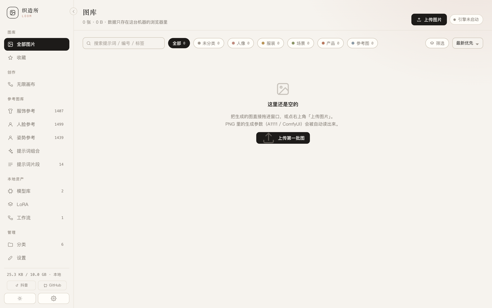

对照检查三件事：

| 检查点 | 应该看到 | 位置 |
|---|---|---|
| ① 左侧有一列菜单 | 图库 / 收藏 / 无限画布 / 服饰参考 / 人脸参考 / 姿势参考 / 提示词组合 / 提示词片段 / 模型库 / LoRA / 工作流 / 分类 / 设置 | 最左边一条竖栏 |
| ② 中间是空的 | 写着「还没有图片」之类的提示 | 右侧大片区域 |
| ③ 最下面有一行小字 | `本地存储 · 计算中…` 几秒后变成 `25.3 KB / 10.0 GB · 本地` | 左下角 |

**三项都对 = 启动成功。** 后面所有操作都基于这个状态。

### 3.4 记住这个地址

终端里那行 `地址：http://127.0.0.1:8787/` 就是程序的网址。

**以后每次启动，浏览器都会自动打开它。** 如果没自动打开，手动把这一行复制到浏览器地址栏也行。

> ⚠️ **不要用「双击 index.html」的方式打开**。那样打开的是 `file://` 地址，浏览器会禁止它读写本地数据库，图存不进去、参考库也加载不出来。必须走 `start.command` / `start.bat`。
>
> 判断方法：看地址栏。`http://127.0.0.1:xxxx/` 是对的，`file:///...` 是错的。

### 3.5 打不开怎么办

| 症状 | 原因 | 怎么办 |
|---|---|---|
| 双击 `start.bat` 闪一下就没了 | 电脑没装 Python，或者 Python 不在 PATH 里 | 装 Python 3.10+（见下方 3.6），装的时候**一定要勾** `Add Python to PATH` |
| Mac 提示「无法验证开发者」 | macOS 的安全机制 | 右键 → 打开 → 再点「打开」 |
| Mac 提示 `permission denied` | 脚本没有执行权限 | 打开「终端」，输入 `chmod +x ` （注意后面有个空格），把 `start.command` 拖进终端窗口，回车 |
| 浏览器显示「无法访问此网站」 | 黑色窗口已经关了，或者被防火墙挡了 | 重新双击启动，看到 `地址：` 那行出现后再看浏览器 |
| 界面能打开，但全是空白 | 用了 `file://` 打开 | 见上面的 3.4 |
| 界面能打开，但提示「数据库打不开」 | 用了 `file://`，或者浏览器处于无痕模式 | 走 `start.command`；无痕模式要关掉 |

### 3.6 如果电脑上完全没有 Python

判断方法：双击 `start.bat`，如果窗口一闪而过，多半就是缺 Python。

**Windows**：

1. 打开 `https://www.python.org/downloads/`
2. 点黄色的 `Download Python 3.12.x` 按钮
3. 下载完双击运行
4. **第一屏最下面有一个复选框 `Add python.exe to PATH`，必须勾上！** 不勾的话后面所有命令都找不到 python
5. 点 `Install Now`
6. 装完**重启电脑**（或者至少重开一个终端窗口）

**Mac**：

Mac 自带的 Python 版本通常是 3.9，**不够用**（ComfyUI 源码要求 3.10+）。

打开「终端」，粘贴这一行回车：

```bash
python3 --version
```

- 显示 `Python 3.10` 或更高 → 够了，跳过这一步
- 显示 `Python 3.9.x` 或 `command not found` → 需要装：

```bash
# 如果你装了 Homebrew（推荐）
brew install python@3.12
```

没装 Homebrew 的话，去 `https://www.python.org/downloads/macos/` 下载 3.12 的安装包，双击安装即可。

> **装完 Python 后**，回到程序目录，重新双击 `start.command` / `start.bat`。

---

## 第 4 章 · 装 ComfyUI 引擎（全自动，不用命令行）

这是整个流程里最省事的一步 —— **你只需要点两个按钮，剩下的全自动**。

### 4.1 打开设置页

**第 1 步**：在左侧菜单最下面，点 **`设置`**。

**第 2 步**：右侧会显示设置页。你会看到最上面有一张卡片，标题类似 **「本地出图引擎 · ComfyUI」**。

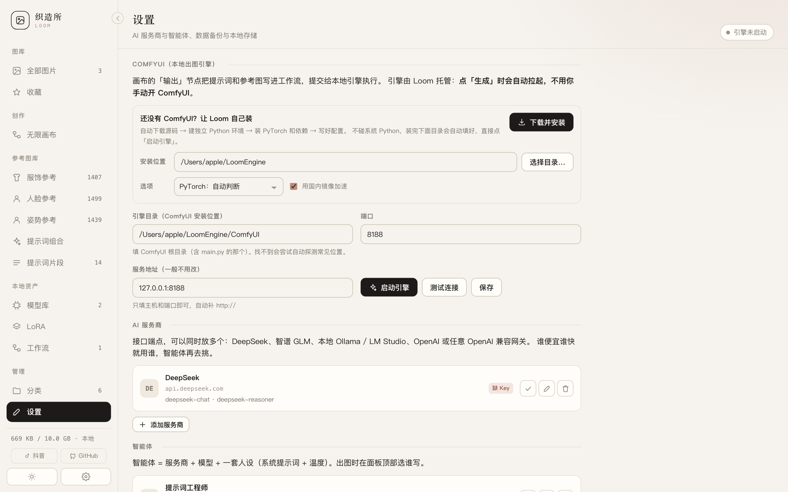

对照检查：

| 检查点 | 应该看到 |
|---|---|
| ① 卡片标题 | 带一个引擎图标，写着「ComfyUI」或「本地出图引擎」 |
| ② 一个「下载并安装」按钮 | 蓝色/深色的主按钮 |
| ③ 一个「安装位置」输入框 | 旁边有个「选择…」按钮 |
| ④ 状态信息 | 可能写「未安装」或「已检测到引擎」 |

### 4.2 选择安装位置

**第 1 步**：点安装位置输入框旁边的 **`选择…`** 按钮。

**第 2 步**：会弹出系统的文件夹选择框。

**第 3 步**：选一个**空间充足**的盘。

| 系统 | 推荐 |
|---|---|
| Windows | `D:\AI` 或者 `D:\ComfyUI` |
| Mac | `/Users/你的用户名/AI` |

> ⚠️ **不要装在 C 盘（系统盘）**。引擎本体约 8 GB，加上模型动不动就 60 GB 以上，C 盘塞满会让整个系统变卡。

**第 4 步**：点「确定」/「选择」。

输入框里会出现你选的路径。

### 4.3 点「下载并安装」

**第 1 步**：点 **`下载并安装`** 按钮。

**第 2 步**：会展开一个进度区域，里面有六个步骤，依次变绿：

```
① 获取 ComfyUI 源码        ← 从 GitHub 下载，几十 MB
② 检查 Python 版本          ← 确认是 3.10 以上
③ 创建独立运行环境          ← 相当于给它准备一个专属的 Python
④ 安装 PyTorch              ← 最大的一个下载，1~2 GB
⑤ 安装 ComfyUI 依赖         ← 一堆小包，几分钟
⑥ 写入配置                  ← 一瞬间的事
```

**第 3 步**：等它自己跑完。全程 5~15 分钟，取决于网速。

**每一步在做什么（看懂了就不慌）**：

| 步骤 | 大概耗时 | 卡在这里怎么办 |
|---|---|---|
| ① 获取源码 | 1~3 分钟 | 如果卡很久，说明 GitHub 慢；程序会自动改用压缩包下载作为备用通道 |
| ② 检查 Python | 几秒 | 如果报「Python 版本太低」，回去看 [3.6](#36-如果电脑上完全没有-python) |
| ③ 创建环境 | 30 秒 | 报错多半是磁盘权限问题，换个安装位置 |
| ④ 装 PyTorch | 3~10 分钟 | 最慢的一步，正常。国内会走镜像加速 |
| ⑤ 装依赖 | 2~5 分钟 | 如果某个包镜像里没有，程序会自动退回官方源重试 |
| ⑥ 写配置 | 1 秒 | — |

> **中途想停**：有个「终止」按钮。停了之后可以再点「下载并安装」继续，已经装好的步骤不会重装。

> **能不能关掉窗口去干别的？** 可以最小化，但**不要关掉那个黑色终端窗口**。

### 4.4 装完的样子

六步全绿之后：

- 卡片上显示「已安装」或类似字样
- 下面的「引擎状态」变成 **在线 / 已启动**
- 顶栏右上角那枚胶囊从 `引擎未启动` 变成 `空闲 · 显存 x%`

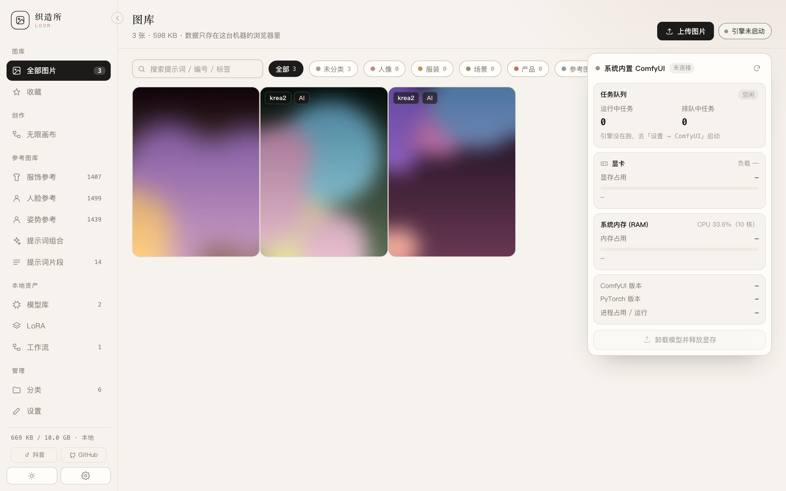

> 如果胶囊还显示「引擎未启动」，去设置页点一下「启动引擎」按钮，等 30 秒左右（第一次要加载一堆东西，比较慢）。

### 4.5 引擎装在哪了？我需要管它吗？

**不需要。** 引擎装在你刚才选的目录里，形如：

```
D:\AI\venv\            ← 专属 Python 环境
D:\AI\ComfyUI\         ← 引擎本体
D:\AI\ComfyUI\models\  ← 模型放这里（下一章重点）
```

平常用的时候完全不用打开这个文件夹。只有放模型的时候需要进去。

---

## 第 5 章 · 放模型（这是唯一必须手动做的体力活）

引擎装好了，但它没有「手艺」—— 模型就是那个手艺。

### 5.1 模型分几种，分别放哪

打开引擎目录下的 `models` 文件夹（例如 `D:\AI\ComfyUI\models`），你会看到一堆子文件夹。

**你只需要关心这三类**：

| 子文件夹 | 放什么 | 单个大小 | 必须吗 |
|---|---|---|---|
| `diffusion_models` | 主模型（也叫底模 / checkpoint / unet） | 2~20 GB | ✅ 必须有 |
| `text_encoders` | 文本编码器（把文字翻译成模型能懂的东西） | 2~10 GB | ✅ 一般配套提供 |
| `vae` | 色彩解码器（决定画面颜色和细节） | 100~300 MB | ✅ 一般配套提供 |

其它子文件夹（`loras` / `controlnet` / `upscale_models` …）先不用管，等你想加「风格」的时候再说。

> **注意 `checkpoints` 和 `diffusion_models` 的区别**：
> 老式的大包模型（一个文件包含全部）放 `checkpoints`；
> 新式的拆分模型（主模型 + 文本编码器 + VAE 分开）放 `diffusion_models`。
> **不确定的话，看下载页面的说明**。本教程配套的内置工作流用的是拆分式，所以放 `diffusion_models`。

### 5.2 本程序自带的那套工作流需要什么模型

首次打开程序时，工作流列表里已经有一条 **「KREA2 CC 人像」**，点开能看到它需要的三个文件（在「设置 → 工作流」或画布的节点上能看到模型名）：

| 文件名 | 放哪个文件夹 |
|---|---|
| `Krea2-MuseByStable_v15Turbo_fp8.safetensors` | `models/diffusion_models/` |
| `qwen3vl_4b_bf16.safetensors` | `models/text_encoders/` |
| `qwen_image_vae.safetensors` | `models/vae/` |

这三个文件的网盘地址写在程序里（工作流的备注里），作者是 B 站的「古手梨花sama」。

> 你也可以用自己已有的模型，只要**在画布上把工作流切换成自己那套**（见 [7.3](#73-选一套工作流)）。

### 5.3 放模型的具体动作

**第 1 步**：从网盘把文件下载到电脑上（推荐先下到「下载」文件夹）。

**第 2 步**：打开模型文件夹。以 Windows 为例：

```
D:\AI\ComfyUI\models\diffusion_models\
```

**第 3 步**：把下载好的 `.safetensors` 文件**剪切**过来（`Ctrl+X` → `Ctrl+V`，Mac 是 `⌘X` → `⌘V`）。

> ⚠️ **不要「复制」**，除非你磁盘空间多到没处花。模型动不动 10 GB，复制一份等于白占 10 GB。

**第 4 步**：等它移动完。**移动过程中不要关闭窗口，也不要点开这个文件。**

**第 5 步**：三类文件（主模型 / 文本编码器 / VAE）分别放进对应的三个文件夹。

### 5.4 怎么确认放对了

程序会**自动扫描**模型目录，不用你手填路径。

**第 1 步**：回到浏览器，点左侧菜单的 **`设置`**。

**第 2 步**：往下滚，找到 **「模型路径」** 那一节。

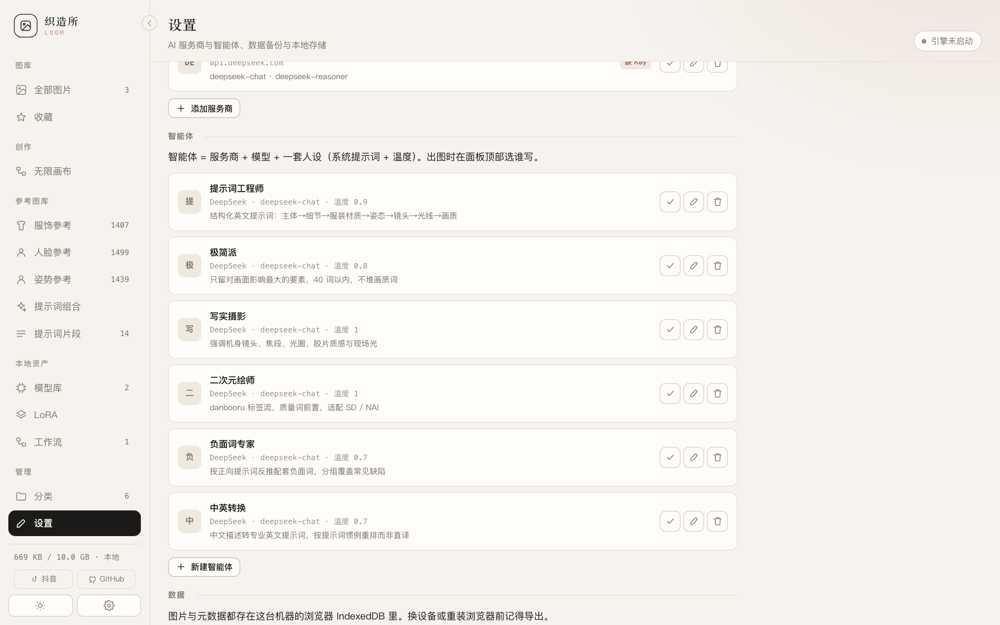

**第 3 步**：点 **`自动识别`**（或打开这一节时会自动扫描）。

你会看到一张表，每行是「模型类型 → 路径 → 有几个模型」：

| 类型 | 路径 | 数量 |
|---|---|---|
| diffusion_models | `D:\AI\ComfyUI\models\diffusion_models` | 1 |
| text_encoders | `D:\AI\ComfyUI\models\text_encoders` | 1 |
| vae | `D:\AI\ComfyUI\models\vae` | 1 |
| … | … | … |

**看到你想要的那个文件夹后面有数字（不是 0）= 放对了。**

> **默认就是 ComfyUI 自己的 `models` 文件夹。** 程序优先读这里 —— 因为 ComfyUI 本身只认这里，放别处还得写配置文件挂载，多一层麻烦就多一个出错点。
>
> 如果你的模型在别的盘（比如 `E:\我的模型`），可以在这一节里手动指定路径，程序会写进 `extra_model_paths.yaml` 让 ComfyUI 认。但**新手强烈建议就用默认的 `models` 文件夹**。

**第 4 步**：如果表格里没显示你刚放的文件，点一下 **`重新扫描`**。

**第 5 步**：如果还是 0 个，检查：

- 文件是不是还在下载中（文件名以 `.qkdownloading` / `.part` / `.tmp` 结尾 = 没下完）
- 是不是放错了子文件夹（放进了 `checkpoints` 但应该是 `diffusion_models`）
- 文件是不是 0 字节（复制过程被打断了）

### 5.5 让引擎认识新模型

放完模型后，**必须重启引擎**，它才会重新扫描目录。

**第 1 步**：设置页 → 找到「重启引擎」按钮 → 点它。

**第 2 步**：等 30~60 秒。顶栏胶囊会先变成「引擎启动中…」，再变成「空闲」。

**第 3 步**：验证 —— 回到画布，点生成节点上的工作流名，看下拉里能不能选到你的模型（或者直接跑一张，能出图就是对的）。

---

## 第 6 章 · 认识界面（每个按钮干什么）

程序左边那一列是「功能区」，点哪个右边就换哪个页面。下面逐个讲，**每个都配截图**。

### 6.1 图库（最常用）

点左侧 **`全部图片`**。


| 区域 | 干什么 |
|---|---|
| **左上角标题「图库」** | 告诉你现在在哪一页 |
| **右上角按钮** | 「上传图片」等操作；最右边那个圆角胶囊是**资源监控**（见 6.8） |
| **中间网格** | 你的所有图片，按时间倒序 |
| **每张图左上角的小标签** | 用过的模型名 / `AI` 标记 |
| **每张图右上角的星星** | 点一下收藏，收藏的图会出现在「收藏」页 |

**怎么导入自己的图**：把图片文件**直接拖进浏览器窗口**，松手即可。会弹出确认框：

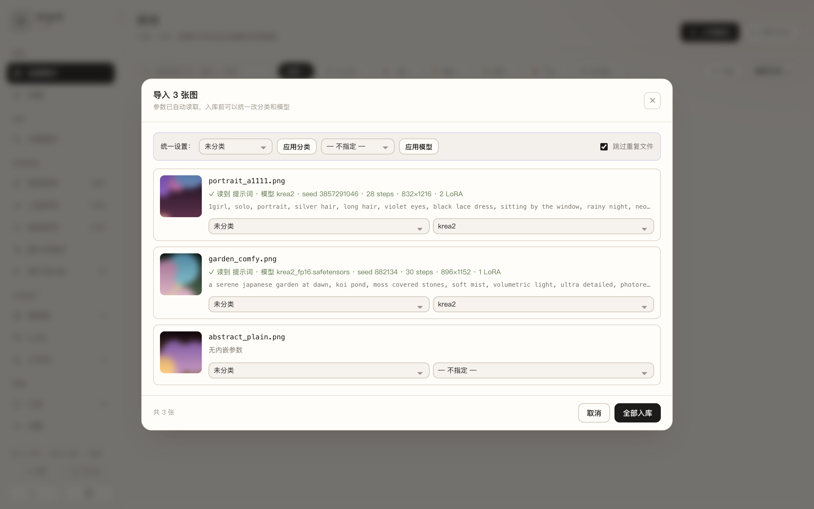

这个弹窗是程序最值钱的地方之一 —— 如果你拖进来的是 AI 生成的 PNG，它会**自动读出当时用的提示词、种子、步数、模型名**，显示在每张图下面：

```
✓ 读到 提示词 · 模型 krea2 · seed 123456789 · 20 steps · 1216×832
```

确认分类没问题，点右下角 **`全部入库`**。

### 6.2 点开一张图（灯箱）

在网格里点任意一张图。

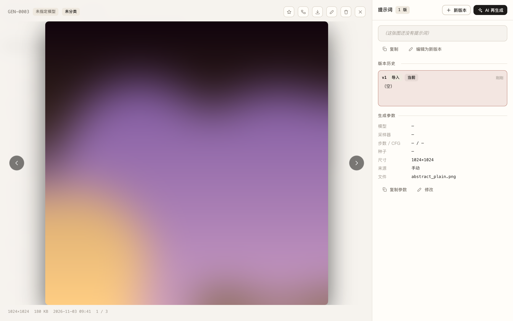

| 区域 | 干什么 |
|---|---|
| **中间大图** | 看细节；滚轮缩放，拖动平移 |
| **右侧面板** | 这张图的全部档案：提示词（可复制）、负向、种子、步数、CFG、模型、尺寸 |
| **提示词下方的版本标签** | 这张图改过几版提示词，可以来回切（历史不覆盖） |
| **底部按钮** | 收藏 / 下载 / 删除 / **送去画布** |

**「送去画布」是核心功能**：点它，这张图的提示词 + 参数 + 参考图会原样变回一套画布节点，你可以改两个字重跑一遍。

关掉：点右上角 `×`，或按 `Esc`。

### 6.3 参考图库（三个）

左侧「参考图库」下面有三项，都是内置的，**不用联网、不用下载**：

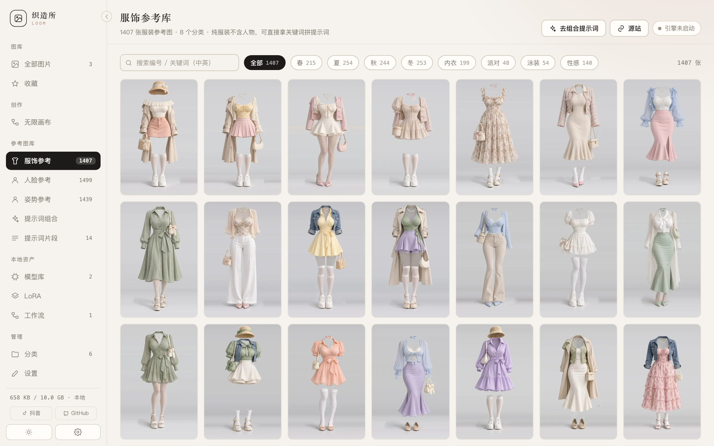

**服饰参考** 1407 条：上方一排「分类」按钮（上衣 / 裙装 / 鞋 / 配饰…），点一下筛选。

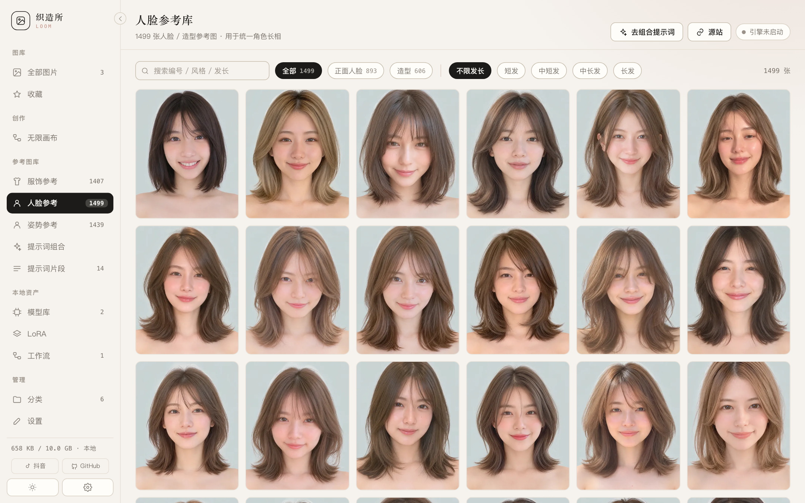

**人脸参考** 1499 条：按「分区 / 发长 / 风格」筛选。

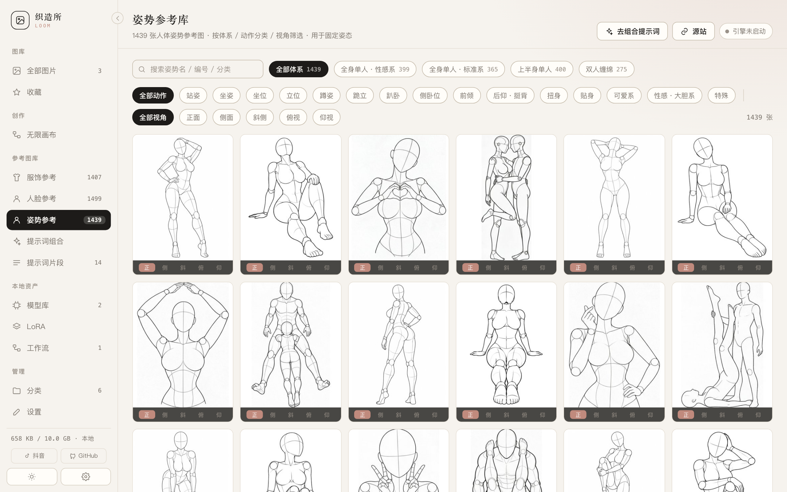

**姿势参考** 1439 条：按「体系 / 分类 / 视角」筛选。

**这三页怎么用**：

1. 鼠标移到任意一张缩略图上，会浮出 **`存入图库`** 和 **`下载`** 两个按钮
2. 「存入图库」= 把它变成你自己的图，之后可以拖到画布当参考图
3. 顶部的搜索框可以按关键词找（比如输入「和服」）

> 缩略图是本地自带的（所以秒开）。点开看大图时才需要联网下载原图 —— 下载过的会缓存，下次离线也能看。

### 6.4 提示词组合台

左侧 **`提示词组合`**。

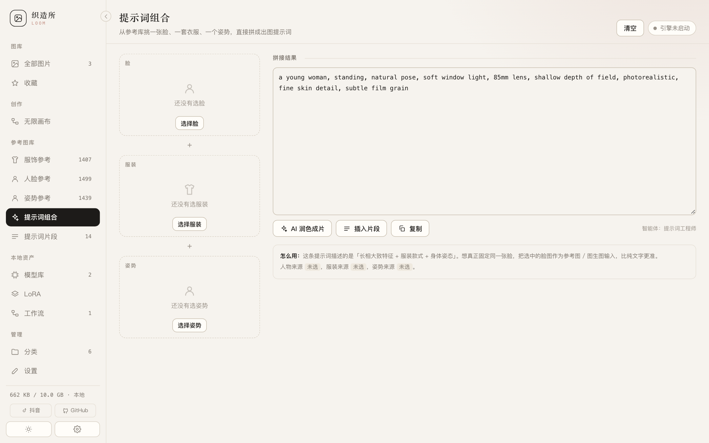

把「服饰 + 人脸 + 姿势」三张参考图凑成一套，右边自动生成一段结构化提示词，一键复制。

适合「我想要这个人的脸 + 这身衣服 + 这个姿势」这种明确需求。

### 6.5 提示词片段库

左侧 **`提示词片段`**。

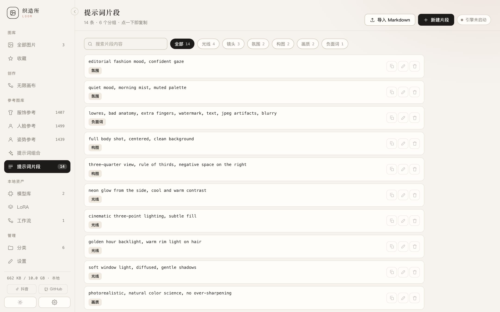

把常用的提示词短语存起来（比如「电影感打光」「浅景深」「胶片颗粒」），写提示词时点一下就插进去，不用每次手打。

自带 14 条，可以自己加。

### 6.6 本地资产（三个）

左侧「本地资产」下面是模型相关的三页。

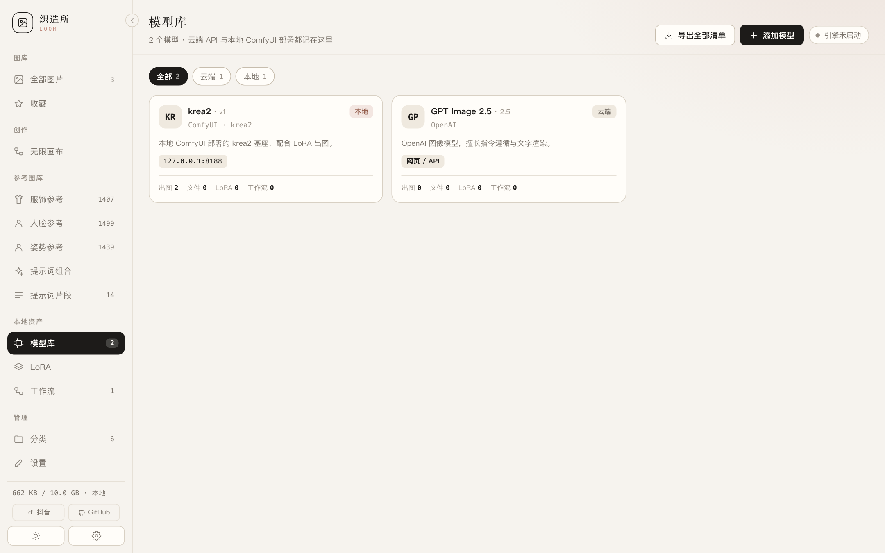

**模型库**：记录你用过的模型 —— 叫什么、在哪个平台、下载链接、放在哪个路径。这是你的「模型账本」，重装系统时照着它重新下载就行。

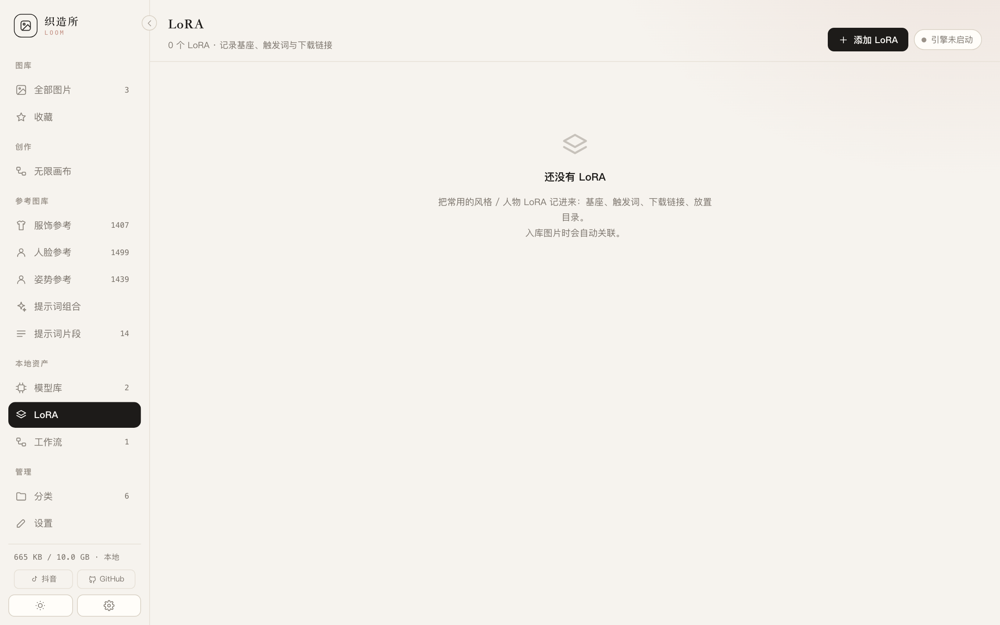

**LoRA**：风格插件。一个 LoRA 文件几十到几百 MB，能让同一个底模画出完全不同的风格。

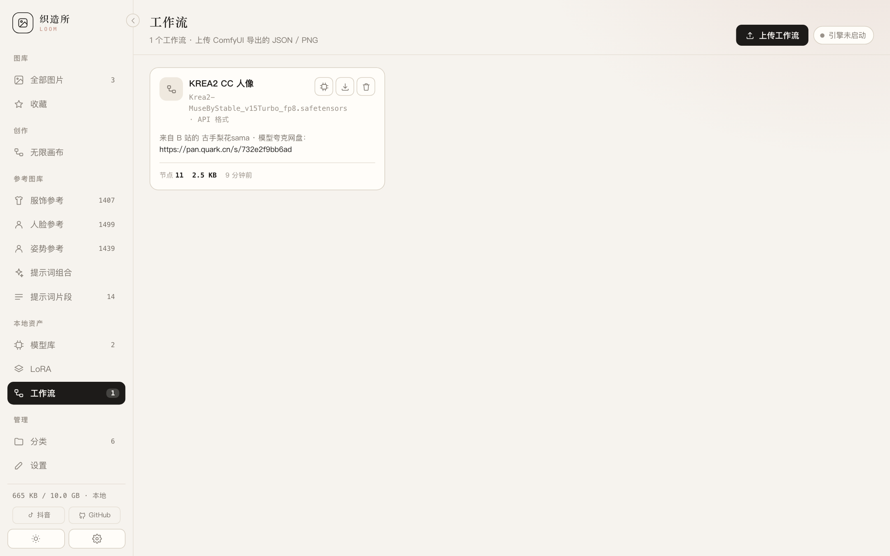

**工作流**：最重要的一页。每一条都是一个「出图配方」，点开能看到节点数、格式、绑定的模型。

第一行那条 **「KREA2 CC 人像」** 是自带的，开箱即用（前提是模型放对了，见第 5 章）。

### 6.7 分类

左侧「管理 → 分类」。

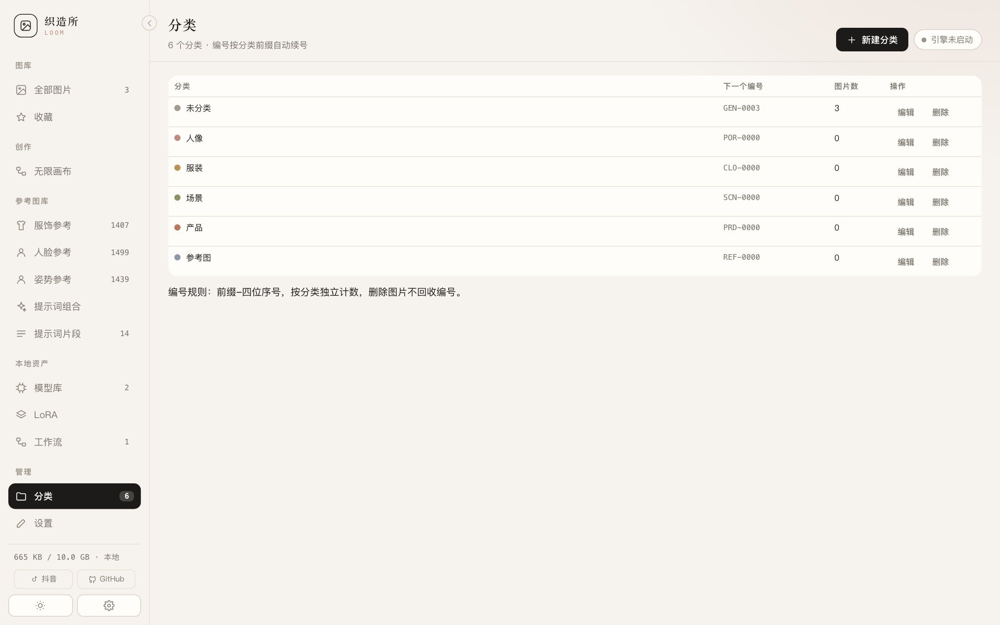

给图片分类用的。自带 6 个分类，每个分类有自己的编号前缀（比如 `GEN-0007` 里的 `GEN`）。

### 6.8 顶栏的资源胶囊

不管你在哪一页，**右上角始终有一枚小胶囊**：

```
● 空闲 · 显存 12%
```

点它展开面板：


| 块 | 看什么 |
|---|---|
| 任务队列 | 正在跑几个、排队几个、这个任务已经跑了多久 |
| 显卡 | 型号、负载、显存占用条（超过 80% 变黄，超过 92% 变红） |
| 系统内存 | 内存占用、CPU 占用与核数 |
| 版本 | ComfyUI / PyTorch 版本、引擎进程吃了多少内存、跑了多久 |
| 最下面的按钮 | **卸载模型并释放显存** —— 换大模型之前点一下，能避免显存不够 |

> **什么时候需要看它**：出图报「显存不足」时、机器变卡时、想知道「还要等多久」时。
> 点面板外面或按 `Esc` 收起。

### 6.9 设置页

左侧「管理 → 设置」。

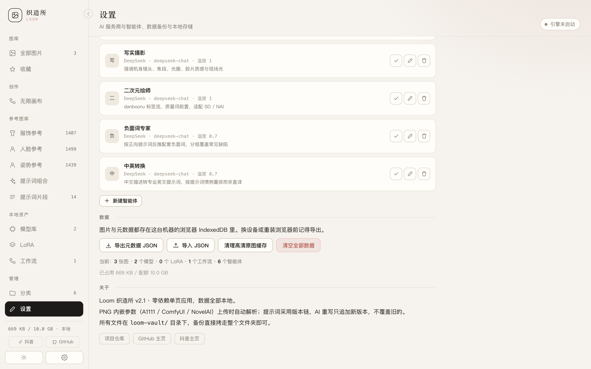

设置页很长，从上往下依次是：

1. **ComfyUI 引擎**：安装、启动、模型路径（第 4、5 章用过）
2. **AI 服务商**：接 DeepSeek / 智谱等大模型，用来帮你写提示词（**可选，不填也能正常出图**）
3. **智能体**：预设的 AI 角色（提示词工程师、翻译官等）
4. **数据**：导出/导入元数据、清空数据

> **新手可以先完全跳过「AI 服务商」这一节**。它只是让 AI 帮你把中文想法翻译成英文提示词，不影响出图。

### 6.10 深色主题

左下角有一个太阳/月亮图标，点一下切换深色：

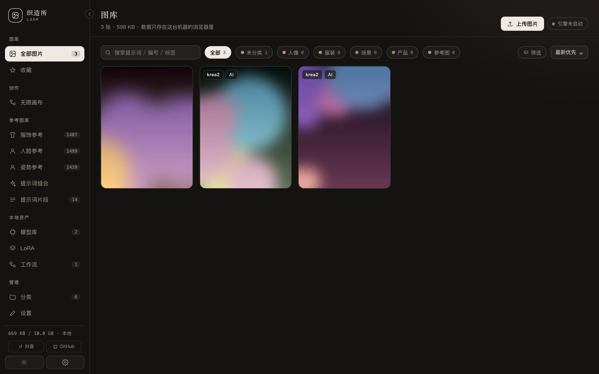

晚上用眼舒服。设置会记住，下次打开还是这个主题。

---

## 第 7 章 · 第一张图：从零到出图

前面都是准备。这一章真的把图生出来。

### 7.1 进入画布

**第 1 步**：点左侧 **`无限画布`**。

**第 2 步**：你会看到一块带灰色点阵的空白区域：

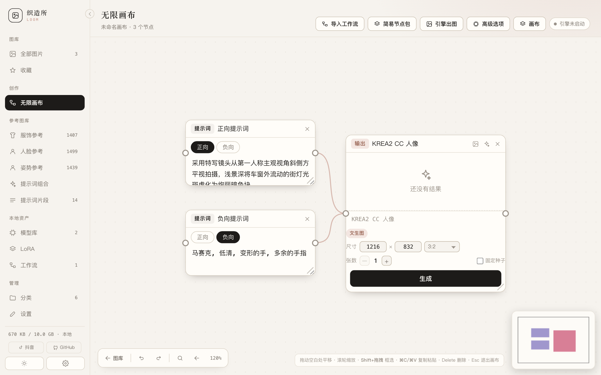

对照认识这几块：

| 位置 | 叫什么 | 干什么 |
|---|---|---|
| 左下角一排按钮 | **工具条（HUD）** | 退出 / 撤销 / 重做 / 适应窗口 / 缩放 |
| 右下角小方框 | **小地图** | 节点多了以后用它导航，点一下跳过去 |
| 底部中间灰字 | **提示条** | 提醒你快捷键，只是文字不能点 |
| 中间大片空白 | **画布** | 放节点的地方 |

**基本操作**（先试一遍，很重要）：

| 想干什么 | 怎么做 |
|---|---|
| 平移画布 | 在空白处**按住拖动** |
| 缩放 | **滚轮**（以鼠标位置为中心） |
| 框住全部节点 | 点工具条的「适应窗口」按钮 |

### 7.2 放一套「三件套」节点

出图最少需要三个节点：**正向提示词 → 输出 ← 负向提示词**。

**第 1 步**：点顶栏的 **`简易节点包`** 按钮。

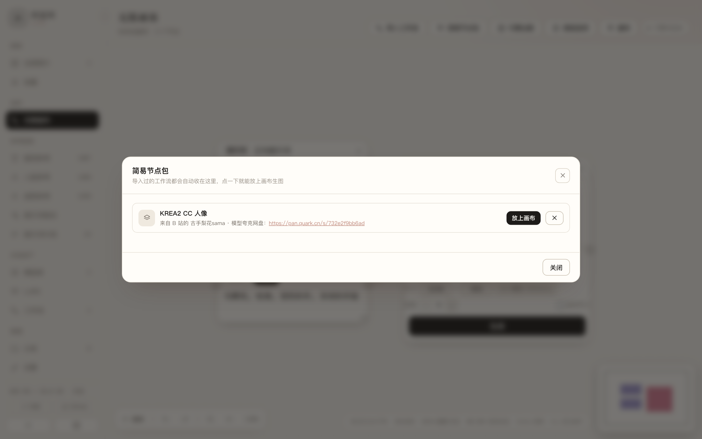

**第 2 步**：弹窗里列出可用的工作流，点 **`KREA2 CC 人像`** 那一行的「放在画布上」。

**第 3 步**：画布上自动出现三个节点和两条连线：

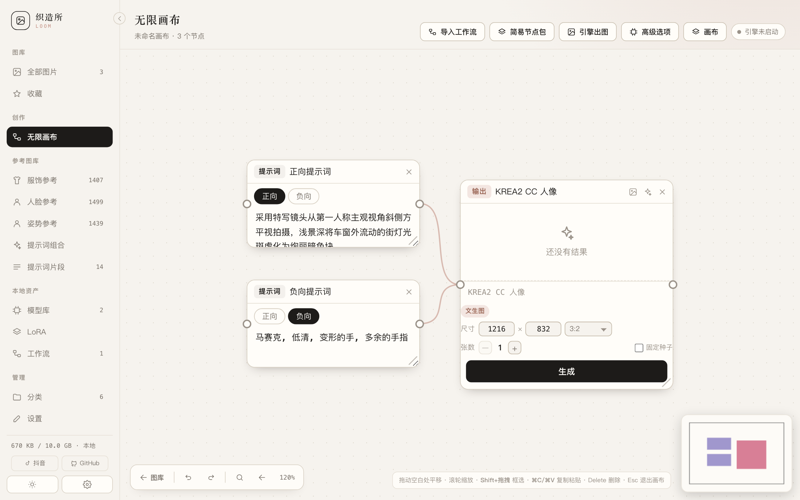

| 节点 | 长什么样 | 作用 |
|---|---|---|
| **正向提示词** | 白卡片，标签写「正向」 | 你想要的画面 |
| **负向提示词** | 白卡片，标签写「负向」 | 你不想要的东西 |
| **输出（生成）** | 大卡片，标题右侧有工作流名 | 真正干活的那个 |

**连线含义**：正向和负向各有一条线连到输出节点左边的圆点。**这两条线必须都有**，少一条就跑不了。

> 点工具条的「适应窗口」，让三个节点刚好铺满屏幕。

### 7.3 选一套工作流

如果输出节点上显示 **「未绑定工作流」**，说明还没选配方。

**第 1 步**：点输出节点上那行 **工作流名**（或者卡片中间的下拉框）。

**第 2 步**：弹出工作流列表，选 **`KREA2 CC 人像`**。

**第 3 步**：选完节点中间那行会变成 `KREA2 CC 人像`，下面出现一排小标签：

```
文生图
```

这行标签是「这套配方支持什么」—— `文生图` 表示纯打字出图，`参考图` 表示可以喂图，`遮罩重绘` 表示可以局部改图，`视频` 表示能出视频。

### 7.4 写提示词

**第 1 步**：点正向提示词卡片里的文字区域。

**第 2 步**：输入你想要的画面。

新手建议先用**英文短句**（模型对英文理解更准），比如：

```
a young woman standing by the window, soft morning light,
film photography, shallow depth of field, 85mm lens
```

或者直接用中文（这个内置工作流支持中文，因为它的文本编码器是多语言的）：

```
一个年轻女生站在窗边，柔和的晨光，胶片质感，浅景深
```

**第 3 步**：点负向提示词卡片，输入不想要的东西：

```
low quality, blurry, deformed hands, extra fingers, watermark, text
```

> **提示词写得不好怎么办？** 先随便写，出图之后再改 —— 每次改都是一次新的尝试，旧版本会存进提示词版本链，不会丢。

### 7.5 设置分辨率（重要，第 8 章详解）

看输出节点中间，有一行 **`尺寸`**：

```
尺寸  [1216] × [832]  [3:2 ▾]
```

- 两个数字是**宽 × 高**（像素）
- 右边的下拉是**常用比例**，点开可以快速换

**第一次跑，建议先用默认的 1216×832 别动**。等第一次成功出图之后，再回来试别的尺寸。

### 7.6 张数

下面一行是 **`张数 − 1 +`**：

```
张数  [−]  1  [+]
```

- **第一次跑就保持 1**
- 想一次出多张就点 `+`，最多 8 张（串行跑，会很慢）
- 右边的 **`固定种子`**：勾上之后同一批图用同一个种子，方便对比「只改提示词」的效果

### 7.7 点生成

**第 1 步**：确认顶栏胶囊不是「引擎未启动」。如果是，先去设置页启动引擎。

**第 2 步**：点输出节点最下面那个黑色大按钮 **`生成`**。

**第 3 步**：按钮变成带转圈的「生成中」，旁边出现 **`取消`** 按钮。

**第 4 步**：观察状态行的变化：

```
准备中…
   ↓
上传参考图…        ← 你没放参考图的话不会有这步
   ↓
提交中…
   ↓
已排队，等待执行…   ← 这时候引擎可能还在加载模型
   ↓
生成中 3/10 · 已用 00:42 · 剩余约 02:10
   ↓
生成中 10/10 · 已用 02:38 · 剩余约 00:05
   ↓
入库中…            ← 把图存进你的图库
   ↓
完成 · 1 张 · 已存 1 张
```

**重点看这一行**：

```
第 1/3 张 · 生成中 8/20 · 已用 00:07 · 剩余约 00:24
```

| 部分 | 意思 |
|---|---|
| `第 1/3 张` | 你设了出 3 张，这是第 1 张 |
| `生成中 8/20` | 采样进度：20 步里跑完了 8 步 |
| `已用 00:07` | 从开始到现在 7 秒 |
| `剩余约 00:24` | 估计还要 24 秒 |

> **「剩余约」是估的**：有步进进度就按每步耗时外推；没有进度就拿你上次跑同一套工作流的耗时倒推。
> 第一次跑某个工作流**不会有「剩余约」**，只显示已用 —— 没历史数据就不编数字。
> 估过头了会显示「快好了」，不会出现负数。

**第 5 步**：等它跑完。

**第一次跑会特别慢**（几分钟到几十分钟），因为引擎要把整个模型从硬盘读进内存/显存。第二次开始就快了。

### 7.8 图出来了

跑完之后：

- 输出节点的卡片里出现那张图
- 状态行写 `完成 · 1 张 · 已存 1 张`
- 右侧自动出现一个图片节点，可以继续往下连

**这就成了。** 你的第一张图已经自动存进图库了（见第 9 章）。

### 7.9 想中途停掉

点 `生成` 旁边的 **`取消`**。

会发生两件事：

1. 通知引擎中断当前任务
2. **把排队里还没开始的一起清掉**

> ⚠️ 一个必须知道的物理限制：引擎**只在每一步之间**检查中断标记。
> 大模型一步就要几分钟，所以点完取消后，它可能还要把**当前这一步**跑完才真的停。
> 状态行会如实告诉你这一点。

### 7.10 用你自己的 ComfyUI 工作流

自带的那套只是「能用」。你肯定会有自己想跑的配方（网上下的、自己搭的）。

**第 1 步**：先在 ComfyUI 里把它**导出成 API 格式**。

- 在 ComfyUI 界面里点齿轮图标 → `导出 (API)`
- ⚠️ 是 **`导出 (API)`**，不是普通的 `保存`
- 普通 `保存` 出来的是 UI 格式，本程序也能导入并自动转换，但转换可能丢细节

**第 2 步**：回到本程序，进画布，点顶栏 **`导入工作流`**。

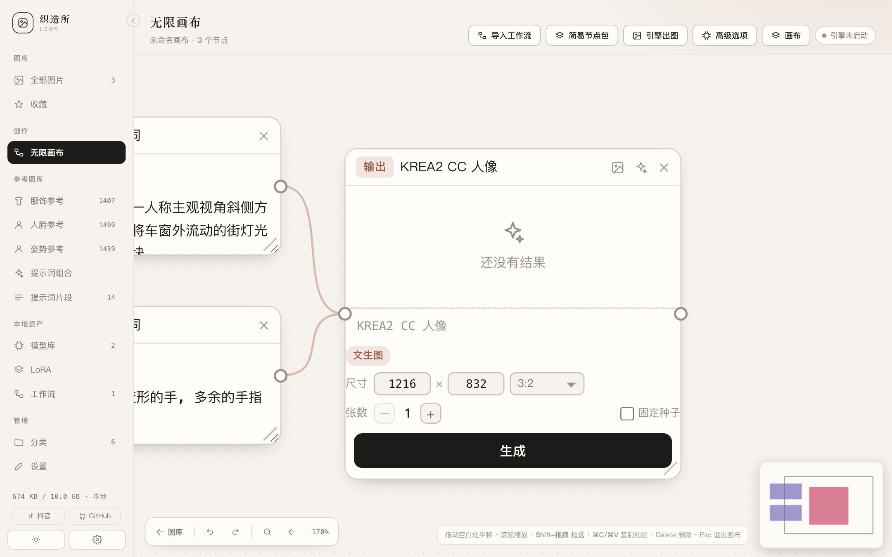

**第 3 步**：把导出的 `.json` 文件拖进弹窗，或者点「选择文件」。

**第 4 步**：导入成功后，画布上会出现一个输出节点，同时这份工作流也会**自动收进「简易节点包」**，以后在别的画布上能一键放。

> **想让新工作流也支持改尺寸 / 换提示词？**
> 在 ComfyUI 里把对应节点的标题（`_meta.title`）改成保留名：
> `prompt` / `negative_prompt` / `seed` / `size` / `steps` / `ref_image_01` …
> 改完再导出，画布上的卡片就会自动长出对应的输入控件。

### 7.11 局部改图：遮罩重绘

只想改画面里的一小块（换个表情、改个背景），不用整张重跑 —— 用遮罩。

**第 1 步**：把要改的图拖进画布，变成图片节点。

**第 2 步**：点图片节点上的 **`遮罩`** 按钮（画笔图标）。

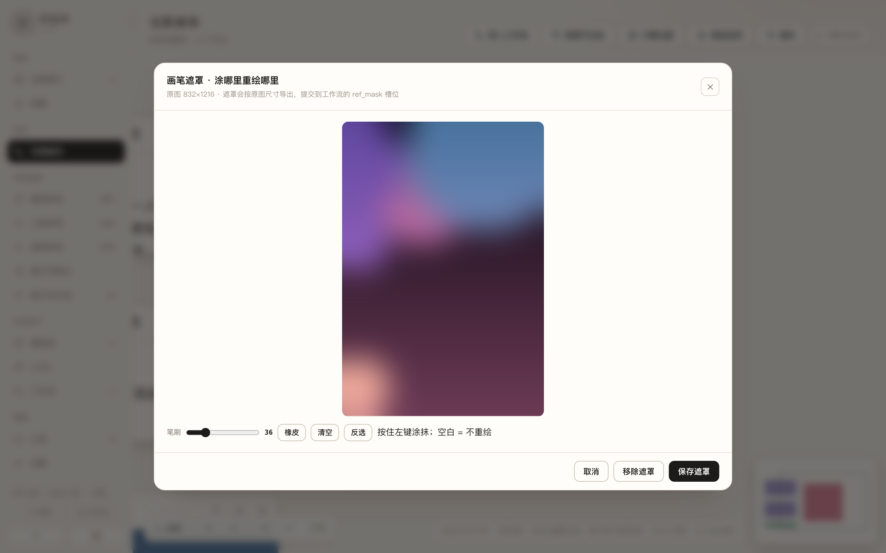

**第 3 步**：在图上**按住左键涂抹**要重绘的区域（涂过的地方会变半透明）。

| 工具 | 作用 |
|---|---|
| **笔刷滑块** | 调笔头大小 |
| **橡皮** | 擦掉涂错的地方 |
| **清空** | 全擦掉重来 |
| **反选** | 涂过和没涂的对调（想「保留这一小块，其它全重画」时用） |

**第 4 步**：点 **`保存遮罩`**。

**第 5 步**：把这个图片节点**连线到输出节点**，然后在提示词里写「改成什么」。

**第 6 步**：点生成。

> 遮罩的工作原理：**涂白的地方重画，没涂的地方原样保留**。
> 这要求工作流里有 `ref_mask` 槽位（标了 `ref_mask` 标题的节点）。
> 没有这个槽位的话，程序会明确提示「遮罩不会生效」，不会假装成功。

---

## 第 8 章 · 调整分辨率（图片和视频都靠这一行）

### 8.1 这一行什么时候出现

输出节点上的 **`尺寸`** 行，**只有工作流本身支持改尺寸时才会出现**。

- 出现了 → 恭喜，可以随便调
- 没出现 → 这套工作流的尺寸写死在节点里，改不了（去 ComfyUI 里把宽高节点的标题标成 `size`，见 8.5）

本程序自带的「KREA2 CC 人像」是支持的，所以你能看到它：

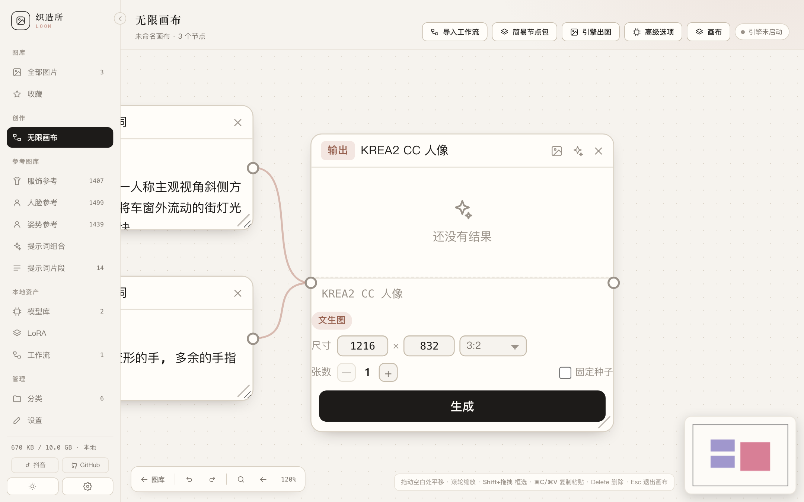

### 8.2 三个控件分别是什么

| 控件 | 怎么用 |
|---|---|
| **左边数字框** | 宽。可以直接打字，也可以点上下箭头（每次 ±64） |
| **中间 `×`** | 只是个乘号，不能点 |
| **右边数字框** | 高 |
| **最右边的下拉** | 常用比例，点开选一个，宽高自动填好 |

### 8.3 尺寸的规矩（很重要，不然会出错）

**规则一：宽高必须是 64 的倍数。**

比如 `1024` ✅、`1000` ❌、`1216` ✅、`1344` ✅。

> 为什么？模型内部把图切成 8×8 的小块来算，尺寸不是 8 的倍数就没法整除，会报错或者被悄悄裁掉。
> 本程序统一按 **64** 取整（比 8 更保险，某些模型要求 64）。
>
> **你输错了会怎样**：输入框失去焦点（点别处）时，会自动吸附到最近的 64 倍数。
> 比如你输 `1000`，松手后会变成 `1024`。所以不用担心记不住。

**规则二：范围是 64 ~ 4096。**

超出的会被夹回边界。

**规则三：越大越慢，而且不是线性的。**

| 尺寸 | 像素总量 | 相对耗时 |
|---|---|---|
| 768×768 | 0.59 MP | 1× |
| 1024×1024 | 1.05 MP | ~1.8× |
| 1216×832 | 1.01 MP | ~1.7× |
| 1536×1536 | 2.36 MP | ~4× |

显存不够的时候，大尺寸会直接报「out of memory」。

### 8.4 常用尺寸速查

| 用途 | 推荐尺寸 | 比例 |
|---|---|---|
| 头像 / 方图 | 1024×1024 | 1:1 |
| 手机壁纸 / 竖图 | 832×1216 或 768×1344 | 2:3 / 9:16 |
| 横图 / 电脑壁纸 | 1216×832 或 1344×768 | 3:2 / 16:9 |
| 打印 / 大图 | 1536×1024 | 3:2 |
| 视频（横屏） | 1280×704 | 16:9 |
| 视频（竖屏） | 704×1280 | 9:16 |

下拉里都有，直接选就行。

### 8.5 视频的尺寸和时长

**视频工作流**的尺寸和图片是**同一套逻辑**（同一个 `尺寸` 行），区别只有两点：

1. **会多出一行「时长」** —— 单位秒，可以填 0.5~60

```
时长  [ 5 ] 秒
```

2. **显存吃得更凶** —— 视频本质是「很多帧图片一起算」，5 秒 24fps = 120 帧。
   同样尺寸下，视频的显存占用大约是单张图的 **10~30 倍**。

**视频新手建议**：

- 先跑 512×512、2 秒，确认能出
- 再逐步加：先加时长，再加分辨率
- 报「显存不足」就退回去，别硬顶

### 8.6 为什么我的节点上没有「尺寸」行

因为你的工作流没有声明它支持改尺寸。

**在 ComfyUI 里怎么声明**（进阶操作，不会的话可以先跳过）：

1. 用 ComfyUI 打开这个工作流
2. 找到那个同时带「宽」和「高」两个输入框的节点（通常叫 `EmptyLatentImage` 或 `EmptyLatentVideo`）
3. 把这个节点的**标题**（双击标题文字）改成 `size`
4. 导出为 API 格式，重新导入本程序

改完之后，画布上就会出现 `尺寸` 行。

> 槽位协议的完整说明见 [README 的「工作流槽位协议」](README.md#工作流槽位协议让-ui-跟着工作流长)。

---

## 第 9 章 · 图去哪了：几种把图找回来的方式

### 9.1 自动进图库

出图完成后，图会**自动存进图库**，不需要你点保存。

- 位置：左侧 **`全部图片`**
- 分类：**未分类**（如果这个分类被你删了，就放到列表里第一个）
- 编号：`分类前缀-四位序号`，比如 `GEN-0007`
- 档案：提示词（作为第 1 版）、参考图、工作流、模型、LoRA、采样器、步数、CFG、种子、尺寸，全都有

### 9.2 状态说「完成但未入库」

如果状态行写 **`完成但没有拿到图片`** 或 **`完成（未入库）`**，常见原因：

| 原因 | 怎么办 |
|---|---|
| 用了 `file://` 打开页面 | 改用 `start.command` / `start.bat` 启动 |
| 浏览器无痕模式 | 关掉无痕模式 |
| 浏览器存储空间满了 | 设置页 →「数据」→ 清理旧图，或者导出备份后删一部分 |
| 工作流里没有保存节点 | 工作流必须有 `SaveImage` 节点，去 ComfyUI 里补一个 |

### 9.3 图已经在引擎里了

有时候图生成成功了，但程序这边没接住（比如你在生成途中刷新了页面）。

**第 1 步**：点画布顶栏的 **`引擎出图`** 按钮。

**第 2 步**：会列出引擎 `output` 文件夹里的所有图。

**第 3 步**：点单张的「导入」，或者「全部导入」。

导入的图一样会解析 PNG 里的生成参数。

### 9.4 刷新页面后任务不会丢

生成中你不小心刷新了页面（或者关掉标签页又打开）：

- 节点记住了引擎那边的**任务编号**
- 重新进画布时，它会**自动把任务接回来**
- 状态行会标 **「刷新后接回」**
- 跑完之后照常入库

**接不回来会明说原因**（比如「任务已不在引擎里」），不会一直转圈骗你。

### 9.5 想把图拿出去用

在灯箱里点 **`下载`**，或者在图库卡片上右键（部分浏览器支持）。

原图是 PNG，尺寸就是生成时的尺寸，没有二次压缩。

---

## 第 10 章 · 出错了怎么办（按症状查）

### 10.1 启动阶段

| 症状 | 原因 | 解决 |
|---|---|---|
| 双击 `.bat` 一闪而过 | 没有 Python / 不在 PATH | 见 [3.6](#36-如果电脑上完全没有-python) |
| `'python' 不是内部或外部命令` | 同上 | 同上 |
| Mac 提示「无法验证开发者」 | macOS 安全机制 | 右键 → 打开 → 再点「打开」 |
| Mac 提示 `permission denied` | 没执行权限 | `chmod +x ` + 拖文件进终端 |
| `端口被占用` / 打开后是别的网页 | 8787 被占了 | 程序会自动换端口，看终端里实际打印的地址 |
| 浏览器打不开 | 终端窗口关了 | 重新双击启动 |
| 页面全白 / 提示「数据库打不开」 | 用了 `file://` | 见 [3.4](#34-记住这个地址) |

### 10.2 引擎阶段

| 症状 | 原因 | 解决 |
|---|---|---|
| 胶囊一直「引擎未启动」 | 引擎没装 / 装失败了 | 设置页看安装卡片的状态，重装 |
| `Python 版本太低` 或 `TypeError: unsupported operand type(s) for |` | 用了 Python 3.9 | 装 3.10+，重装引擎 |
| 引擎启动后卡住不动，端口没监听 | 环境被污染 | 设置页「重启引擎」；仍不行就重装引擎 |
| 装依赖时某个包失败 | 镜像滞后 | 程序会自动退回官方源，等它自己重试；连续失败就换安装位置重来 |
| 启动超时（180s） | 第一次启动要加载很多东西 | 再等一会儿，或看终端里的日志 |
| 报 `missing_node_type` | 工作流用了没装的插件节点 | 在 ComfyUI 里装对应插件，或者换一个工作流 |

### 10.3 出图阶段

| 症状 | 原因 | 解决 |
|---|---|---|
| `这个生成节点还没绑定工作流` | 输出节点没选配方 | 见 [7.3](#73-选一套工作流) |
| `这个工作流没有 ref_image_xx 槽位` | 工作流不支持参考图 | 换一个带 `ref_image_01` 标注的工作流 |
| `工作流只有 N 个图位，多出的 M 张没用上` | 参考图比图位多 | 删掉多余的参考图，或者换支持更多图位的工作流 |
| `这个工作流里没有 LoadImage 节点` | 老式工作流，没有图片输入 | 换工作流 |
| `执行结束但没有输出图片` | 工作流没有 `SaveImage` 节点 | 去 ComfyUI 里补一个保存节点 |
| `显存不足 / out of memory` | 尺寸太大 / 模型太大 | 调小尺寸、点资源面板的「卸载模型并释放显存」、关掉别的占显存的程序 |
| `连不上 ComfyUI（…）` | 引擎没跑 / 地址不对 | 设置页「测试连接」，确认地址和端口 |
| 卡在「生成中 233s」不动 | 连不上 WebSocket，退回轮询了 | **正常现象，功能一样**，只是看不到步数。等着就行 |
| 一直「已排队，等待执行…」 | 队列前面还有任务 | 看资源面板的任务队列，等前面的跑完 |
| 生成很慢（20 分钟以上） | 模型太大 + 内存不够 | 换小模型（fp16 的 SDXL 约 6.5 GB）、缩小尺寸 |

### 10.4 界面相关

| 症状 | 原因 | 解决 |
|---|---|---|
| 图片显示成破图 | 浏览器缓存坏了 | `Ctrl+Shift+R`（Mac 是 `⌘⇧R`）强制刷新 |
| 左侧菜单点不动 | 黑色终端窗口被关了 | 重新启动程序 |
| 换了浏览器数据不见了 | IndexedDB 按「源」隔离 | 认准一个浏览器用；定期用设置页导出备份 |
| 参考图库图片加载不出来 | 缩略图文件缺失 | 运行 `scripts/fetch_reference_gcore.py` 重新拉一次 |
| 界面错位 / 按钮重叠 | 窗口太窄 | 把浏览器窗口拉宽（建议 1280 以上） |

### 10.5 一个万能的自查顺序

出问题时按这个顺序查，90% 的问题能定位：

```
1. 黑色终端窗口还在吗？           → 关了就是程序停了
2. 地址栏是 http:// 还是 file://？ → file:// 啥都不对
3. 胶囊显示「引擎未启动」吗？      → 去设置页启动引擎
4. 资源面板里 GPU/内存有数吗？     → 全都没数 = 引擎真没跑起来
5. 模型路径那一节后面是 0 吗？     → 0 = 模型没放对地方
6. 工作流绑定了吗？               → 显示「未绑定工作流」就选一个
7. 提示词写了吗？                 → 空的也能跑，但用的是工作流默认词
8. 尺寸是不是太大？               → 先退回 1024×1024 试试
```

---

## 附录 A · 文件都放哪了（一张表看完）

```
┌─ 你解压出来的这个文件夹 ─────────────────────────────┐
│  loom-vault/                                        │
│  ├── start.command / start.bat   ← 双击启动           │
│  ├── serve.py                    ← 服务本体           │
│  ├── assets/                     ← 界面代码           │
│  ├── reference/                  ← 4300 张参考图       │
│  ├── demo/                       ← 3 张示例图          │
│  └── .engine.json                ← 记住引擎装在哪（自动生成）│
└─────────────────────────────────────────────────────┘

┌─ 你选的引擎目录（比如 D:\AI） ───────────────────────┐
│  AI/                                                │
│  ├── venv/                       ← 专属 Python 环境   │
│  └── ComfyUI/                                       │
│      ├── main.py                 ← 引擎入口           │
│      ├── models/                 ← ★ 模型放这里        │
│      │   ├── diffusion_models/   ←  主模型            │
│      │   ├── text_encoders/      ←  文本编码器        │
│      │   ├── vae/                ←  色彩解码器        │
│      │   ├── loras/              ←  风格插件          │
│      │   ├── checkpoints/        ←  老式整包模型       │
│      │   └── ...                                     │
│      ├── output/                 ← 出图临时存放       │
│      └── extra_model_paths.yaml  ← 外部模型路径（自动生成）│
└─────────────────────────────────────────────────────┘

┌─ 你的图存在哪 ───────────────────────────────────────┐
│  浏览器内部的 IndexedDB（不是文件夹）                  │
│  · 换浏览器看不到                                   │
│  · 清浏览器数据会丢                                 │
│  · 想备份 → 设置页「导出元数据 JSON」                 │
└─────────────────────────────────────────────────────┘
```

---

## 附录 B · 三个最容易搞混的概念

| 概念 | 一句话解释 | 类比 |
|---|---|---|
| **模型（底模 / checkpoint）** | 决定「能画什么风格」的大文件 | 画师本人 |
| **LoRA** | 在底模上加一个「风格滤镜」 | 给画师的参考图册 |
| **工作流** | 一串节点的连接方式，决定「怎么画」 | 作画步骤说明书 |

三个都要对，才能出图：

- 模型放错位置 → 引擎找不到，报错
- LoRA 没放对 → 工作流加载失败
- 工作流没绑定 → 点生成没反应

---

## 附录 C · 从零到出图的「一遍通」清单

打印出来照着勾：

```
□ 1. 下载 ZIP 并解压到固定位置（不要 Program Files）
□ 2. 双击 start.command / start.bat
□ 3. 终端出现「地址：http://127.0.0.1:xxxx/」
□ 4. 浏览器自动打开，左侧有菜单
□ 5. 左侧「设置」→ 选安装位置（不要 C 盘）
□ 6. 点「下载并安装」，等六个步骤全绿
□ 7. 从网盘下载三个模型文件
□ 8. 主模型 → models/diffusion_models/
□ 9. 文本编码器 → models/text_encoders/
□ 10. VAE → models/vae/
□ 11. 设置页「模型路径」→ 自动识别 → 数字不是 0
□ 12. 设置页「重启引擎」，等胶囊变「空闲」
□ 13. 左侧「无限画布」
□ 14. 顶栏「简易节点包」→ 选 KREA2 CC 人像
□ 15. 检查两个提示词节点都有线连到输出节点
□ 16. 正向提示词写画面，负向写不想要的东西
□ 17. 尺寸保持 1216×832，张数保持 1
□ 18. 点「生成」
□ 19. 看状态行从「准备中」走到「完成」
□ 20. 左侧「全部图片」，看到你的第一张图 ✅
```

---

## 还卡着？

1. 先看 [第 10 章](#第-10-章--出错了怎么办按症状查) 的表格，按症状查
2. 再按 [10.5 的自查顺序](#105-一个万能的自查顺序) 走一遍
3. 还不行就去 GitHub 提 issue，**记得贴上**：
   - 终端窗口里的完整输出
   - 浏览器按 `F12` → `Console` 标签里的红色报错
   - 你卡在哪一步（第几章第几小节）

---

*本教程对应程序版本见 [CHANGELOG.md](CHANGELOG.md)。截图均来自当前版本的真实界面。*
